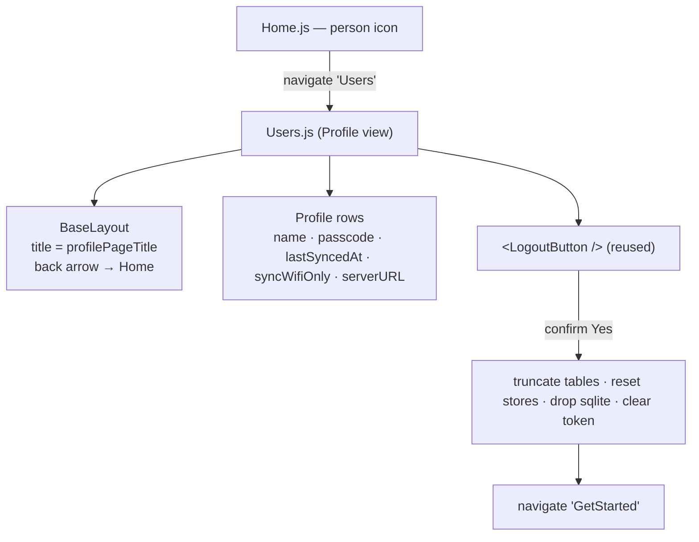
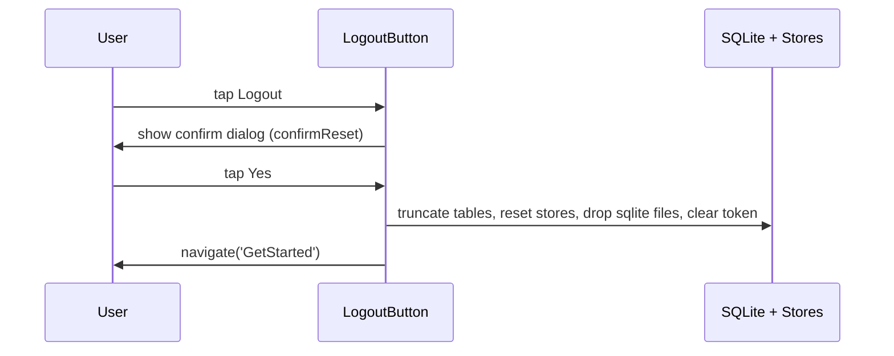

# Feature Design Document

## Feature: Repurpose the Users page into a single-user Profile + Logout view

**Task ID**: APP-558
**Author**: Iwan Firmawan
**Date**: 2026-10-26
**Status**: Approved — Implemented

---

## 1. Context & Problem Statement

```
Currently:
- The mobile app is single-user per device, but `app/src/pages/Users.js`
  renders a FlatList of users and lets the operator switch between them
  (toggleActive, swap token + passcode via crudConfig.updateConfig).
- Logout already exists as a self-contained `<LogoutButton />` component
  (app/src/components/LogoutButton.js), already used in Settings.js.
- The branch (feature/558-mobile-app-rename-reset-to-logout) already renames
  the "Reset" label to "Logout" in i18n (buttonReset).

Goal:
- Replace the user-switching list with a read-only Profile view that shows the
  current user plus sync/status info, and surfaces logout by reusing the
  existing `<LogoutButton />`.
- Do NOT support switching between multiple users — the product has
  confidently decided a device holds one user.
```

Scope: repurpose `Users.js`, **plus** remove the now-duplicate `<LogoutButton />`
from `Settings.js` (logout lives only on the Profile page). Removing the broader
multi-user machinery (`AddUser` page, `crudUsers.toggleActive`, Home person-icon
label, multi-user seeding) is explicitly deferred to a later cleanup.

---

## 2. Requirements

### User Acceptance Criteria
- [x] Opening the page (Home → person icon) shows the current user's name and
      sync/status info — no user list, no switch action.
- [x] A Logout action triggers the existing confirm dialog and, on confirm,
      performs the full reset and returns to the `GetStarted` screen.
- [x] Back arrow (header) and hardware back both return to Home.

### Technical Acceptance Criteria
- [x] `Users.js` no longer references `crudUsers.getAllUsers` /
      `crudUsers.toggleActive` / `crudConfig.updateConfig` / `api.setToken`.
- [x] Logout is rendered via `<LogoutButton />` — no duplicated logout logic.
- [x] The passcode IS shown (to identify the exact account when multiple users
      share the same name) and is `selectable` so it can be copied; the auth
      `token` is never rendered.
- [x] Page title comes from a new i18n key (`profilePageTitle`), not an
      overloaded `usersPageTitle`, with `en` + `fr` values.
- [x] Passes frontend ESLint/prettier (arrow callbacks, braces, no `console`).

---

## 3. Data Model Changes

**None.** No SQLite schema change, no new columns. The view reads existing
data only:

| Source | Field | Use |
|--------|-------|-----|
| `UserState` | `name` | Display name |
| `crudUsers.getActiveUser(db)` | `password` (passcode) | Identify the exact account (names can collide) |
| `crudUsers.getActiveUser(db)` | `lastSyncedAt` | Last synced timestamp |
| `UserState` / `users` row | `syncWifiOnly` | Sync-on-WiFi-only flag |
| `BuildParamsState` | `serverURL` | Server the device is paired to |

---

## 4. API Contract

**None.** No backend endpoints are added or changed. The page is fully
offline and reads local SQLite + Pullstate only.

---

## 5. Component Design

### Structure



### Logout flow (unchanged — provided by existing component)



### Rendering notes (as built)
- Loads the active user row once on mount (`crudUsers.getActiveUser(db)`) for
  `password` (passcode) and `lastSyncedAt`; shows `profileNeverSynced`
  ("Never" / "Jamais") when `lastSyncedAt` is null.
- The passcode row renders with `selectable` on its `<Text>` so it can be
  long-pressed and copied, letting the operator confirm which account is active
  when two users share a name. (See §8.)
- `lastSyncedAt` is formatted with `new Date(...).toLocaleString()` — no new
  dependency.
- `syncWifiOnly` renders as `buttonYes`/`buttonNo` ("Yes"/"No").
- Profile rows are a `{ label, value }[]` mapped into list rows styled after
  `Settings.js` for visual consistency; a person-icon + name header sits on top.
- Keeps the existing `BackHandler` effect (hardware back → Home) and the header
  back arrow.

### Also changed outside `Users.js` (as built)
- `app/src/components/LogoutButton.js`: icon changed from `refresh` to
  `log-out-outline` (shared component — updates the glyph on Profile; Settings no
  longer renders it).
- `app/src/pages/Settings.js`: removed the `<LogoutButton />` and its redundant
  divider + unused import (logout now lives only on Profile).
- `docs/source/mobileApp.rst`: new "Profile and logging out" section, Settings
  "Reset" block replaced with a pointer, troubleshooting "Reset" → "Logout".

### Removed from `Users.js`
- `FlatList`, `handleSelectUser`, the `route.params.added` reload effect,
  `useState([])` for the users list, and imports of `crudUsers.getAllUsers` /
  `crudUsers.toggleActive` / `crudConfig` / `api` / `AuthState` that only
  served switching.

---

## 6. Decision Log

### D-1: Reuse `<LogoutButton />` vs. inline the logout

**Options Considered**:
1. Reuse the existing `<LogoutButton />` component.
2. Re-implement the confirm + reset logic inside `Users.js`.

**Decision**: Reuse (1).

**Rationale**: The component already does the complete, tested reset
(truncate 8 tables, reset 5 stores, drop sqlite, clear token, navigate). It is
already used in Settings.js, so behaviour stays consistent across the two
entry points. Re-implementing would duplicate a data-loss-sensitive path.

**Impact**: `Users.js` imports one component; no logout logic lives there.

### D-2: Keep route name `Users`, retitle to "Profile"

**Options Considered**:
1. Keep `Stack.Screen name="Users"`, change only the visible title.
2. Rename route + file + all `navigate('Users')` callers to `Profile`.

**Decision**: Keep the route name, change the title (1).

**Rationale**: Avoids navigation churn and test updates across Home.js,
AddUser.js and their tests for a cosmetic rename. Lowest risk for the scoped
change. A full rename can happen in the deferred multi-user cleanup.

**Impact**: New i18n key `profilePageTitle`; `usersPageTitle` is left for the
deferred cleanup to remove.

### D-3: Show the passcode on the Profile screen

**Options Considered**:
1. Hide the passcode (treat it as a secret, show only name + status).
2. Show the passcode in plain text.

**Decision**: Show it (2).

**Rationale**: Multiple users can be created with the same display name, so
name alone does not identify which account is active. The passcode is the
unique identifier the operator recognises. It is their own code, on their own
device, already known to them — showing it there leaks nothing to a third
party.

**Impact**: Profile adds a passcode row; §8 security note records the tradeoff
and its revisit condition.

---

## 7. Compatibility & Migration

### Backward Compatibility
- [x] No API consumers affected (no API change).
- [x] Existing local data preserved (read-only view).
- [x] Navigation entry points unchanged (`navigate('Users')` still valid).

### Mobile App Impact
- [x] Sync endpoints affected: none
- [x] SQLite schema changes: no
- [x] Version detection: not required (UI-only change)

### Seeder/CLI Compatibility
- [x] Existing seeders work (device still seeds one active user).

---

## 8. Security Considerations

- [x] The auth `token` is never rendered.
- [x] The passcode (`users.password`) **is** rendered — a deliberate product
      choice (D-3) to disambiguate same-name accounts. Acceptable because it is
      the operator's own passcode on their own device, which they already know
      and typed to log in; it is not exposed to any third party or sent off
      device. Revisit if the Profile screen ever becomes shareable/castable.
- [x] No new input fields — the view is read-only, so no new input-validation
      surface.
- [x] Logout fully clears token, stores and local DB (existing behaviour).

---

## 9. Testing Strategy

| Test Type | Coverage | Status |
|-----------|----------|--------|
| Unit (RNTL) | Profile renders current user name + passcode value from mocked `getActiveUser`. | ✅ pass |
| Unit (RNTL) | Logout button present (`list-item-logout`), no user list (`users-list` absent). | ✅ pass |
| Unit (RNTL) | Tapping logout opens the confirm dialog (`dialog-confirm-logout`). | ✅ pass |
| Unit (RNTL) | Hardware back navigates to Home. | ✅ pass |
| Unit (RNTL) | Title translates `Profile` → `Profil` on `UIState.lang` change. | ✅ pass |

`app/src/pages/__tests__/Users.test.js` was rewritten (old list/switch
assertions and snapshot dropped); **5/5 pass**, ESLint + prettier clean.

**Test-infra notes** (needed to make the suite run under jest-expo):
- Stub `expo-task-manager` + `expo-background-task` — rendering `<LogoutButton />`
  pulls in the background-sync chain that otherwise throws
  `Cannot find native module 'ExpoTaskManager'` (the known ~60-suite failure).
- `import { BackHandler } from 'react-native'` is `undefined` under jest-expo, so
  the hardware-back test uses `jest.spyOn(BackHandler, 'addEventListener')` to
  capture the handler rather than the old submodule mock.

---

## 10. Open Questions

- [x] Final set of status fields — **resolved**: name, passcode, last synced,
      sync WiFi-only, server URL. Passcode included to identify the exact
      account when names collide (D-3, §8).
- [x] Title i18n key — **resolved**: `profilePageTitle` (`en` + `fr`), plus a
      label key per status row.

---

## 11. References

- Implementation: `app/src/pages/Users.js`
- Reused component: `app/src/components/LogoutButton.js` (icon → `log-out-outline`)
- Settings change: `app/src/pages/Settings.js` (`<LogoutButton />` removed)
- i18n: `app/src/lib/i18n/ui-text.js` — new keys `profilePageTitle`,
  `passcodeLabel`, `syncWifiOnlyLabel`, `serverLabel`, `profileNeverSynced`
  (`en` + `fr`); existing `buttonReset` already relabelled to "Logout" on this
  branch.
- Tests: `app/src/pages/__tests__/Users.test.js`
- User docs: `docs/source/mobileApp.rst`
- Requirements brief: `/sc:brainstorm` session (this branch)

---

## Approval

| Role | Name | Date | Status |
|------|------|------|--------|
| Developer | Iwan Firmawan | 2026-10-26 | Approved |
| Tech Lead | | | |
| Product | | | |
