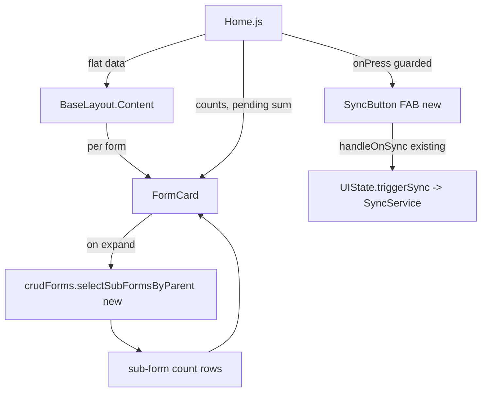

# Feature Design Document

> Written for: mobile engineers implementing APP-585. Assumes familiarity with the
> APP-481 cards, the bottom-tab navigator, `SyncService`, and the Pullstate stores.
>
> Single plan for APP-585 — merges the requirements discovery (`/sc:brainstorm`) and
> the design (`/sc:design`) into one document.

---

## Feature: Home screen redesign — per-form submission counts

**Task ID**: APP-585
**Author**: Iwan Firmawan
**Date**: 2026-11-24
**Status**: Draft
**Design source**: Claude canvas "MIS app – Home submission counts"
(artboards 1·Today, 2·Proposed counts per form, 2b·Offline, 2c·Floating sync, 3·sub-form expanded)
**Builds on**: [APP-481](APP-481-mobile-cards-list-items.md), [APP-569](APP-569-instant-sync-on-submit.md)

---

## 1. Context & Problem Statement

```
Issue #585 is design feedback on the shipped Home screen. Discovery found that MOST of
the canvas is ALREADY SHIPPED by APP-481 — so this is a small view-layer feature, not a
"wire up counts" build.

Already built (reuse, do not rebuild):
- FormCard (components/FormCard.js) renders version + Submitted/Draft/Synced counts,
  theme colors, and a per-form sync progress bar.
- crudForms.selectLatestFormVersion already computes draft / submitted (= pending
  upload) / synced / registered PER FORM, with sub-forms rolled into the parent totals
  (mf.parentId = f.formId). No new top-level count query is needed.
- Offline state: StatusBanner + "You're offline..." already wired via UIState.online.
- Home.js already has handleOnSync(), isOnline, syncLoading and the triggerSync path.
- Profile button top-right (APP-558), themed search bar, empty state — all present.

The feedback (and the gap between the canvas and the shipped screen) reduces to three deltas:

  Δ1  Flat list.  Today the list is split into Latest/Earlier sections, cards grouped in
      one container with dividers. Canvas wants one flat list, each form its own rounded card.
  Δ2  Sub-form expander.  Canvas (artboard 3) expands a card to show each sub-form with its
      own counts. Today sub-forms are only rolled up; the per-sub-form breakdown exists only
      on FormOptions and is uuid-scoped. Needs ONE new form-level query.
  Δ3  Floating sync button.  Canvas replaces the bottom Sync tab with a floating button
      (a tab press implies navigation; sync stays on Home). Remove SyncTab; move its guard
      logic onto the button.

Goal:
- Ship Δ1–Δ3 by reusing the APP-481 components and query, with the smallest diff.
```

**User story**: As a fieldworker, I open Home and see, for every form, how many submissions
are drafted, waiting to sync, and already synced — and I can expand a form to see the same
breakdown per sub-form, and sync from a clear button — without drilling into a form.

---

## 2. Scope decisions & resolved conflicts (confirmed 2026-11-24)

| # | Decision | Resolution |
|---|---|---|
| D1 | Counts depth | Counts are **already live** from `selectLatestFormVersion`; this is a display/view change, not a new count pipeline. |
| D2 | List structure | **Flat card list** — drop the Latest/Earlier split. No realistic case above ~5 forms per assignment. APP-481's `lastActivityAt`/`locallyCreated` sort becomes dead code on Home and is removed. (was conflict C2) |
| D3 | Sync affordance | **Floating button** replacing the bottom `SyncTab`, same behaviour. A tab press implies navigating away; sync stays on Home, so a button is the honest control. (was conflict C1) |
| D4 | Draft tile | **Kept.** Drafts are a local-only state (Kobo Collect model): they live on the device and never sync. 3 tiles, not 2. (was conflict C3) |

---

## 3. Requirements

### User Acceptance Criteria
- [ ] U1 Home shows **one flat list** of form cards; the Latest/Earlier sections and the `latestData`/`earlierData` split are gone.
- [ ] U2 Each card keeps the live **Draft / Pending / Synced** counts and **Version: N** it shows today; a zero renders muted.
- [ ] U3 A card with sub-forms shows an **"N sub-form(s)"** footer (with aggregated monitoring chips) and a chevron up/down; expanding shows each sub-form as its own **display-only** card with its own Draft/Pending/Synced counts. No sub-forms → no expander.
- [ ] U4 A **floating sync button** with a total-pending badge; visibly disabled + explained (offline toast / banner) when offline; reflects in-progress.
- [ ] U5 Search still filters by form name; empty state (no forms) and the `canAddForms` arrow are intact; tapping a card still opens `Submission` with the same params.

### Technical Acceptance Criteria
- [ ] T1 No SQLite schema change; no backend change. Local read-only.
- [ ] T2 Top-level counts stay sourced from `selectLatestFormVersion`, edited (Change 1) so they are **parent-only** — never rolled up with child/monitoring rows.
- [ ] T3 Exactly **one new read query** for the per-sub-form breakdown; one aggregate call (not N), run lazily on first expand and cached.
- [ ] T4 `SyncTab` removed from `navigation/index.js`; none of its online/offline/in-progress guards are lost.
- [ ] T5 All colors via `useTheme()`; ESLint Airbnb clean (reduce pattern, no `for..of`, no `await`-in-loop).
- [ ] T6 Dead code removed: Home's section split and `lastActivityAt` sort; `SectionHeader` no longer used by Home.
- [ ] T7 Touch targets ≥ 44px; tiles legible at 4.5:1 in light and dark.

---

## 4. Data Model Changes

**No model or SQLite schema change.** `datapoints` (`submitted`, `syncedAt`, `locallyCreated`,
`form`, `user`) and `forms` (`parentId`, `formId`, `latest`) already carry everything.

### Count semantics (per datapoint — reference)
- **Draft** = `submitted = 0` (local-only, never synced — D4)
- **Pending sync** = `submitted = 1 AND locallyCreated = 1 AND syncedAt IS NULL` (labelled "Submitted" today)
- **Synced** = `submitted = 1 AND locallyCreated = 1 AND syncedAt IS NOT NULL`
- **registered** (card title suffix) = backend-held registrations (downloaded + synced); parent-only today

### Change 1 — parent-only card counts in `selectLatestFormVersion` (D-5)

**Counts must NOT mix parent and child.** Today the parent card's `submitted` / `draft` /
`synced` each roll the monitoring (child) rows in via a `+ COALESCE((SELECT … mf.parentId =
f.formId …), 0)` term ([crud-forms.js:22-63](../../app/src/database/crud/crud-forms.js#L22)), so a
registration with 2 own + 2 monitoring shows **4**. The requirement is **2 on the registration
card, 2 in the monitoring sub-form** — so **remove those three child subquery additions**. The
parent-own `COUNT` term is already the first operand, so this is a deletion. `registered` and the
(to-be-removed) `lastActivityAt` are already parent-only — leave `registered` as is.

Only Home/Content read these counts; `SyncService.js:268` uses only `.formId`. Safe to change.

### Change 2 — new query `crudForms.selectSubFormsByParent` (read-only)

Breaks out each sub-form's own counts for the expander (Δ2). Same count expressions, grouped
by the child form, scoped by `parentFormId` — independent of the parent card.

```sql
-- selectSubFormsByParent(db, { parentFormId, user })
SELECT
  f.id, f.formId, f.version, f.name,
  COUNT(DISTINCT CASE WHEN dp.submitted = 0 THEN dp.id END)                        AS draft,
  COUNT(DISTINCT CASE WHEN dp.submitted = 1 AND dp.locallyCreated = 1
                       AND dp.syncedAt IS NULL     THEN dp.id END)                 AS submitted,  -- pending
  COUNT(DISTINCT CASE WHEN dp.submitted = 1 AND dp.locallyCreated = 1
                       AND dp.syncedAt IS NOT NULL THEN dp.id END)                 AS synced
FROM forms f
LEFT JOIN datapoints dp ON f.id = dp.form AND dp.user = ?
WHERE f.parentId = ? AND f.latest = 1
GROUP BY f.id, f.formId, f.version, f.name;
-- binds: [user, parentFormId]
```

With Change 1 the card and the expander are now **independent**: the registration card shows
the registration form's own counts, each sub-form shows its own. Numbers no longer overlap, so
`Registration: 2` + `Monitoring: 2` — never a merged `4`.

**Version-agnostic counting (header == sum of cards).** Both the header aggregate (subDraft/
subPending/subSynced on the parent row) and `selectSubFormsByParent` count a child's datapoints
across **all versions of its formId** (`JOIN forms v ON v.formId = f.formId`), scoped to the
current (latest) children. So a monitoring row saved under an earlier form version still lands
on its child's card, and the collapsed header chips always equal the sum of the sub-form cards.

### Badge total-pending count

Because the card is now parent-only, the sync badge can't be `sum(card.submitted)` — that would
drop monitoring's pending rows. Use a dedicated device-wide count instead:

```sql
-- crudDataPoints.countPendingSync(db, { user })
SELECT COUNT(*) AS pending FROM datapoints
WHERE submitted = 1 AND locallyCreated = 1 AND syncedAt IS NULL AND user = ?;
```

### Local data / query contract

| Consumer | Source | Change |
|---|---|---|
| Flat list (title, version, draft/submitted/synced, `registered`) | `crudForms.selectLatestFormVersion` | **Change 1** — drop child roll-up so counts are parent-only |
| Total pending badge on the sync button | `crudDataPoints.countPendingSync` (new) | New query — device-wide, includes monitoring |
| Sub-form expander rows | `crudForms.selectSubFormsByParent` (new) | Lazy on first expand, per parent, cached |
| Sync trigger | `handleOnSync()` in Home | Reused by the button |

---

## 5. Component design



**Home.js**
- Remove the `filteredData` → `latestData`/`earlierData` split and the `lastActivityAt` sort.
- Build one flat, name-filtered list; pass it to `Content` in flat mode.
- Add `<SyncButton>` (absolute, bottom-right) with `pending` from `countPendingSync`
  (device-wide, incl. monitoring — not a sum of the parent-only cards), `online={isOnline}`,
  `syncing={syncLoading}`, `onPress={handleOnSync}` behind the existing online / not-in-progress guards.
- `goToUsers`, empty state, update dialog, GPS/notification effects: unchanged.
- **Refresh:** besides the existing `refreshPage` path, add a `navigation.addListener('focus')`
  that re-runs `getUserForms()` — a safeguard so returning to Home after a submission always
  refetches the cards and the pending badge, even if a `refreshPage` tick is missed.

**Content.js** — add a **flat mode**: given a flat list (or one untitled section), render each
form as its own rounded `FormCard` wrapper with a gap — no `SectionHeader`, no dividers. Keep
the existing section mode for any other caller.
- **Sub-form freshness:** the expander's per-sub-form rows are fetched lazily and cached by
  formId, but an effect **refetches the open parents' sub-forms whenever `data` changes** (a
  `useRef` mirror of the cache avoids a dependency loop). Without this the cached cards showed
  stale counts after a new submission while the header chips updated — the "header 1 / card 0"
  symptom.

**FormCard.js** (`home` variant) — add optional expander (Q3 resolved):
- Props: `subFormCount`, `expanded`, `onToggleExpand`, `subForms` (rows), `loadingSubForms`,
  `onPressSubForm(id)`.
- `subFormCount > 0`: footer button "N sub-form(s)" with a **chevron up/down** (`chevron-up` /
  `chevron-down`) that only signals collapsible — no `chevron-forward`, no other action on it.
  The footer also shows the **aggregated monitoring totals** as colored chips (non-zero only),
  so sub-form status is visible while collapsed. These come from separate `subDraft`/`subPending`/
  `subSynced` columns on `selectLatestFormVersion` — computed from child rows but NOT summed into
  the parent tiles (parent stays parent-only).
- Expanded: render each sub-form as its **own card** (reuse the `home` FormCard with its
  draft/pending/synced counts), not a chevron row. Sub-form cards are **display-only** (not
  tappable): a monitoring form is tied to a specific registration datapoint (shared uuid), and a
  Home card has no uuid, so opening one directly would show an unscoped/empty list. The real
  drill-path stays Home parent card → Submission (registration list) → a datapoint → FormOptions →
  its Monitoring Forms (which carries the uuid). (Reverses the earlier Q3 "tappable" answer.)
- Count label (Q2 resolved): the `home` variant labels the middle stat **"Pending sync"**
  (new i18n key `statPending`), *not* `statSubmitted`. The `monitoring` variant keeps
  `statSubmitted` — its `submitted` prop (from `getFormOptions`) means "all submitted", a
  different figure, so the shared key must not be renamed.
- No `subFormCount` → renders exactly as today. `monitoring` variant untouched.

**Tile tokens (Q1 resolved)** — introduce distinct Draft/Pending/Synced tile tokens in
`lib/theme.js` to match the canvas filled tiles, instead of the plain coloured numbers today.
Add a `tile` group, `{ bg, fg }` per state, light values from the canvas; dark values derived
per the existing dark-block convention (muted translucent bg, lighter fg, kept ≥ 4.5:1):

| State | Light bg / fg (canvas) | Dark |
|---|---|---|
| Draft | `#FFF1DB` / `#8A4B00` | derive |
| Pending sync | `#E3EEFF` / `#1B4F9C` | derive |
| Synced | `#E1F4E8` / `#17623A` | derive |

FormCard renders each count inside a filled tile using these tokens; retire the inline
`status.warning` / `text.primary` / `status.success` number colours on the `home` variant.

**SyncButton.js** (new, small) — presentational FAB: icon, optional pending badge, disabled/
offline styling, in-progress state. No store access of its own; Home passes props.

**navigation/index.js** — delete the `SyncTab` screen, `SyncPlaceholder`, `SyncTabIcon`, and the
`syncInProgress` read used only by it. `HomeTabs` renders Home + Settings. Back-handler /
`currentPage` logic is unaffected (keys are `Home` / `HomeTab`).

---

## 6. Decision Log

### D-1: Flat list — per-card containers, drop sections
**Options**: (A) keep `Content` section rendering, pass one untitled section; (B) add a flat
branch rendering each form as its own rounded card.
**Decision**: B. **Rationale**: the canvas shows separate rounded cards with gaps, not one
grouped container; a single untitled section still renders the grouped container. A flat branch
is a small explicit addition and lets Home drop the grouped/section code.

### D-2: Sub-form expander data — new form-level query, not `getFormOptions`
**Options**: (A) reuse `getFormOptions` (uuid-scoped); (B) new `selectSubFormsByParent` (form-scoped).
**Decision**: B. **Rationale**: `getFormOptions` counts one registration datapoint's monitoring
children; Home needs every sub-form of a parent across all its datapoints — different scope.

### D-3: Floating button replaces the Sync tab
**Decision**: Remove `SyncTab`, button only (D3/C1). **Rationale**: a tab press implies
navigating away; sync keeps the user on Home. **Impact**: button calls the existing
`handleOnSync()` behind the same guards; bottom bar becomes Home + Settings.

### D-5: Parent and child counts are separate, not rolled up
**Options**: (A) keep APP-481's roll-up (parent tile = own + children, so `4`); (B) parent card
shows parent-only counts, monitoring shown separately in the expander (`2` + `2`).
**Decision**: B (user requirement — counts must not mix). **Rationale**: a fieldworker reads the
registration card as "my registration submissions"; folding monitoring in makes the number
unexplainable until expanded. **Impact**: remove the three child subquery additions from
`selectLatestFormVersion` (Change 1); badge moves to a device-wide `countPendingSync` so total
pending still includes monitoring. **Behaviour change vs APP-481** — call out in the PR.

### D-4: Relabel the home card's middle stat to "Pending sync"
**Decision**: Yes. Add a new i18n key `statPending` ("Pending sync") used by the `home` FormCard
variant. **Do not** rename the shared `statSubmitted` — the `monitoring` variant (FormOptions)
reuses it for a different figure ("all submitted", sync-agnostic, from `getFormOptions`).
**Impact**: new key in `lib/i18n/ui-text.js` (English; other locales fall back until translated);
one-line swap in `FormCard` for the `home` variant.

---

## 7. Compatibility & Migration

### Backward compatibility
- [x] Local-only; no API consumers affected.
- [x] No SQLite schema change; existing rows read unchanged.
- [x] `getFormOptions` / FormOptions screen untouched.

### Mobile app impact
- Sync endpoints affected: none (reuses the existing upload path).
- SQLite schema changes: no.
- Navigation: `SyncTab` removed — update any test asserting `tab-sync` / `SyncTab`.
- `FormCard` `home` variant gains optional props with today's render as the default, so other
  callers are unaffected.

---

## 8. Testing Strategy

| Test type | Coverage |
|---|---|
| Unit (real SQL) | `src/database/crud/__tests__/crud-forms-counts.test.js` — runs the actual queries against in-memory SQLite (`better-sqlite3`, dev-only). Covers: parent-only counts (own=2+monitoring=2 → **2**, not 4); **header aggregate == sum of sub-form cards** (the 2-vs-1 bug); monitoring datapoint on an older child version attributed to the latest card (cross-version); orphan form excluded from BOTH header and cards; draft counts downloaded rows while pending/synced require `locallyCreated`; user scoping; `countPendingSync` device-wide. 11 tests, all green. |
| Component | `FormCard` expander: hidden when `subFormCount=0`, rows when expanded, loading state. `SyncButton`: online/offline/in-progress render + press guard. |
| Integration | Home renders flat list; search filters; empty state + `canAddForms` arrow intact; tap → `Submission` with same params. |
| Navigation | Bottom bar has Home + Settings only; no `SyncTab`; sync still fires from the button. |

Pre-existing mobile jest baseline (ExpoTaskManager mock) is red independently of this change —
see memory `mobile-test-suite-preexisting-failures`; don't attribute those failures here.

---

## 9. Open Questions — all resolved 2026-11-24
- [x] Q1 → **Distinct tile tokens.** New `tile.{draft,pending,synced}` `{bg,fg}` in `theme.js`
  (filled tiles per canvas); see §5 Tile tokens.
- [x] Q2 → **Relabel "Pending sync".** New `statPending` key on the `home` variant only; see D-4.
- [x] Q3 → **Sub-forms render as display-only cards.** Expander uses a chevron up/down
  (collapsible signal only, no chevron-right). Cards are NOT tappable: a monitoring form needs its
  registration's uuid, which Home doesn't have, so a direct tap would open an empty list. Reach
  monitoring via the registration datapoint (FormOptions). See §5 FormCard.

---

## 10. Implementation order
Smallest-risk first:
1. **Δ3** — `SyncButton` + remove `SyncTab` (self-contained, reuses `handleOnSync`).
2. **Δ1** — `Content` flat mode + strip Home's section split/sort.
3. **Δ2** — parent-only counts (Change 1) + `selectSubFormsByParent` + `countPendingSync` + `FormCard` expander (the new data paths).

Next step: `/sc:implement`. No implementation until this plan is approved.

---

## 11. References
- Prior art: [APP-481](APP-481-mobile-cards-list-items.md) (cards + counts), [APP-569](APP-569-instant-sync-on-submit.md) (sync path)
- Code: `app/src/pages/Home.js`, `components/BaseLayout/Content.js`, `components/FormCard.js`,
  `database/crud/crud-forms.js`, `navigation/index.js`
- Design canvas: "MIS app – Home submission counts"

---

## Approval

| Role | Name | Date | Status |
|------|------|------|--------|
| Developer | | | |
| Tech Lead | | | |
| Product | | | |
