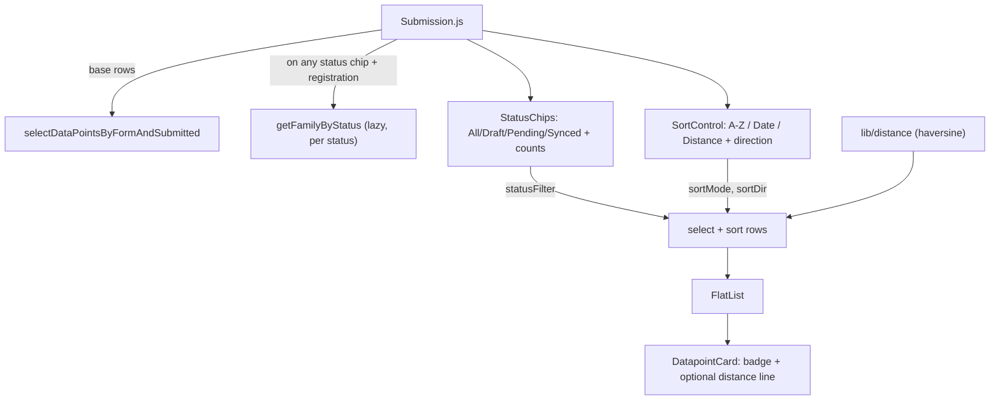

# Feature Design Document

> Written for: mobile engineers implementing APP-596. Assumes familiarity with
> `Submission.js`, the datapoint crud layer, and the APP-481/APP-585 cards.
>
> Single plan — merges the requirements discovery (`/sc:brainstorm`) and the design
> (`/sc:design`). Implementation follows via `/sc:implement`.

---

## Feature: Submission list — status filters + sort (A-Z / date / distance)

**Task ID**: APP-596
**Author**: Iwan Firmawan
**Date**: 2026-11-26
**Status**: Approved (developer) — implemented & device-checked
**Design source**: Claude canvas, artboards **4 · form detail**, **5 · sorted A to Z**, **6 · sorted by distance**
**Relates to**: #585 mobile redesign; builds on [APP-481](APP-481-mobile-cards-list-items.md), [APP-585](APP-585-home-screen-redesign.md)

---

## 1. Context & Problem Statement

```
Currently (pages/Submission.js):
- The datapoint list is a SectionList split into collapsible "Latest"/"Earlier"
  sections (by sortAt). A "drafts only" checkbox toggles submitted vs drafts; on a
  registration list it widens to the whole form family (getFamilyDrafts), grouped
  by form. Default shows submitted only. No sort, no status filter.

Design (artboards 4/5/6):
- One flat list. Status filter CHIPS with counts (All / Draft / Pending / Synced).
- A 3-way SORT toggle (A-Z name, Created date, Distance) with a direction arrow and
  a label ("Latest first" / "A to Z" / "Nearest first").
- Distance: per-card "N m/km away", a "No location recorded" group, nearest first.
- Each card: name, meta ("Registered DD/MM/YYYY · <monitoring summary>"), circular
  status badge (draft amber / pending blue / synced green).

Goal:
- Replace the sections + checkbox with a flat list + status chips + sort.
```

**User story**: As a fieldworker, I open a form's datapoint list and filter by status
and sort by name, date, or distance from me — so I find the right datapoint fast,
including the nearest one in the field.

---

## 2. Scope decisions (confirmed 2026-11-26)

| # | Decision | Resolution |
|---|---|---|
| D1 | Filter default | **All by default**; chips filter by the datapoint's own status; the drafts-only checkbox is removed. |
| D2 | Draft chip scope | **Keep family-wide drafts** on registration lists (reuse `getFamilyDrafts`). See C1. |
| D3 | Distance sort | **Registration lists only**; haversine from `currentLocation` to each row's `geo`; "No location recorded" group; nearest first. |
| D4 | Default sort | **Latest first** (created date, desc). |
| D5 | Persistence | **Reset per visit** — sort + filter are component state. |
| D6 | Monitoring lists | Status chips + A-Z + Date sort apply; **no** Distance. |
| D7 | Header kebab | **Deferred**. |

---

## 3. Requirements

### User Acceptance Criteria
- [ ] U1 One flat list — no Latest/Earlier sections, no collapse.
- [ ] U2 Status chips **All / Draft / Pending / Synced** with live counts; tap filters; **All** default (draft + pending + synced together).
- [ ] U3 Sort toggle: **A-Z** (name), **Date** (created), **Distance**; active mode shows its direction; a label reflects it.
- [ ] U4 Default sort **Latest first** (date desc).
- [ ] U5 Distance (registration lists only): per-card "N m away" (<1 km) / "N.N km away"; rows without `geo` in a **"No location recorded"** group; nearest first. The Distance toggle is **hidden** when the device has no current location (Q1).
- [ ] U6 Name search still works, combined with the active chip + sort.
- [ ] U7 Card tap unchanged (draft → edit, submitted → details/FormOptions); drafts keep swipe-to-delete.
- [ ] U8 Draft chip keeps family-wide drafts on registration lists, **grouped by form with a divider/header showing each form's name** (registration first, then monitoring forms — today's grouping); `openFamilyDraft` still loads another family form on tap.
- [ ] U9 Per-chip empty states read sensibly (e.g. "No drafts", not "no datapoints").

### Technical Acceptance Criteria
- [x] T1 No SQLite schema change. Reuse `selectDataPointsByFormAndSubmitted`; add `getFamilyByStatus` / `countFamilyByStatus` (registration + monitoring family, parameterized by status).
- [x] T2 Counts (registration list) are family-wide via `countFamilyByStatus` (Draft/Pending/Synced all include monitoring, matching Home); `all = base rows`. Monitoring list derives from loaded rows.
- [ ] T3 Distance from `currentLocation.coords` + parsed `geo`; pure util, no network.
- [ ] T4 Remove `SectionList`/collapse code; sort/filter is local state, resets on unmount.
- [ ] T5 Tokens via `useTheme()` (reuse APP-585 `tile`/`status`); ESLint Airbnb clean; no `await`-in-loop.
- [ ] T6 Touch targets ≥ 44px; 4.5:1 contrast both themes.

---

## 4. Data & query contract

**No schema change.** Status derives from existing columns, **matching Home's tile semantics**
(`crud-forms.selectLatestFormVersion`):
- `draft = submitted 0`
- `pending = submitted 1 ∧ syncedAt NULL ∧ locallyCreated 1`
- `synced = submitted 1 ∧ syncedAt ≠ NULL ∧ locallyCreated 1`

**Master data exclusion:** registrations downloaded from the server (`locallyCreated 0`, with
`syncedAt` set) are **not** the user's synced work — they are master/reference data. So they are
excluded from Pending and Synced (as on Home). They still appear under **All** (the list must show
them so the user can add monitoring); All ≥ Draft+Pending+Synced by that difference.

### Row sources (by active chip)

| Chip | Registration list | Monitoring list (uuid) |
|---|---|---|
| All | **base rows** = `selectDataPointsByFormAndSubmitted(db,{form,user})` (this form's registrations) | same, scoped by `uuid` |
| Draft / Pending / Synced | **family rows** = `getFamilyByStatus(db,{formDbId,backendFormId,user,status})` — the registration form AND its monitoring forms, for that status, grouped by form | base rows filtered client-side |

- **Every status chip on a registration list is a family view** (not just Draft): it shows the
  registration's and its monitoring forms' submissions of that status. Family rows are loaded
  **lazily per status** on first selection and cached (`familyRows[status]`).
- Chip **counts** (registration list): `all = base.length`; `draft/pending/synced` from
  **`countFamilyByStatus`** (one query, family-wide) — so Pending/Synced include monitoring, like
  Draft, matching Home. Monitoring list: counts derived from the loaded rows.
- `pending`/`synced` require `locallyCreated = 1` (master data excluded); `draft = submitted 0`.

### Distance (new util `lib/distance.js`)

```
parseGeo("lat|lng")            -> { lat, lng } | null   // null when absent/malformed
haversineMeters(a, b)          -> number                // great-circle metres
formatDistance(meters, trans)  -> "120 m away" | "2.1 km away" | "18 km away"
```

Origin = `UserState.currentLocation?.coords` (`{ latitude, longitude }`, set by Home's GPS watch).
Each row's coordinate is `parseGeo(d.geo)` **or**, when the `geo` column is empty, `geoFromAnswers(d.json, geoQuestionIds)`. The fallback matters for **server-downloaded master data**: its
`geo` column is null (sync-datapoints stores `jsonData.geolocation`, which is absent), but the GPS
lives in the `geo`-type question's answer (`[lat, lng]`). `geoQuestionIds` come from the form JSON
(`question.type === QUESTION_TYPES.geo`). Rows with neither go to the "No location recorded" group.

### Sort key

Keep a **raw** `createdTs` (do not sort on the display string). **Date sort ("Latest first") uses a
family activity timestamp** on registration rows: `activityTs = max(registration date, newest
monitoring submittedAt)` (from `getMonitoringStats.lastSubmissionAt`), so a plot with recent
monitoring sorts first; family submission rows fall back to their own `createdTs`. Name sort uses
`localeCompare`; distance sort uses the computed metres.

---

## 5. Component design



**Submission.js — state machine (all local, resets on unmount — D5)**
- `statusFilter`: `'all' | 'draft' | 'pending' | 'synced'` (default `'all'`).
- `sortMode`: `'date' | 'name' | 'distance'` (default `'date'`).
- `sortDir`: `'asc' | 'desc'` per mode; selecting a new mode applies its default direction (date→desc "Latest first", name→asc "A to Z", distance→asc "Nearest first"); tapping the **active** mode flips `sortDir`.
- `familyCounts` ({draft,pending,synced}) + `familyRows` (cache keyed by status), lazily loaded on a registration list.
- Derived `filteredRows` + `listData` (useMemo): pick source by chip (§4), apply name search, compute distance when needed, group + sort. Replaces today's `datapoints`/`sections` memos.
- Keep: `fetchData` (family counts via `countFamilyByStatus`), `onClickItem`, `openFamilyDraft`, swipe-delete, `getMonitoringStats` meta, `restoreFormOnFocus`/`beforeRemove` listeners.
- `goToDetails` loads the row's **own** form (`selectFormById`) and swaps `FormState.form` when the row belongs to another family form (a monitoring submission), so `FormDataDetails` parses the right definition; the focus/beforeRemove listeners restore the registration form on return.
- Remove: `SectionList`, `sections`, `collapsed`/`toggleSection`, `renderSectionHeader`, the drafts-only `CheckBox`, `draftsOnly`.

**List rendering** — `FlatList` (not SectionList), with a single **group-header sentinel**
mechanism that carries a label, reused for every grouped case:
- **Plain** (All/Pending/Synced, or monitoring Draft): `data = sortedRows`, no headers.
- **Family Draft** (Draft chip on a registration list): grouped by form, a header row per form
  showing the form name — `[{header: regName}, ...regDrafts, {header: monName}, ...monDrafts, …]`.
  Order follows `getFamilyDrafts` (registration first, then monitoring form name). Within a group,
  rows still obey the active sort.
- **Distance**: `data = [...located(sorted), ...(noLoc.length ? [{header: 'No location recorded'}, ...noLoc] : [])]`.
- `renderItem` branches on the sentinel (renders a header vs a `DatapointCard`); `keyExtractor`
  gives sentinels a stable key.

**StatusChips** (new, small, presentational): four chips with label + count, colored from `theme.tile`/`status`; `active` chip filled; `onSelect(status)`. Hidden counts render muted.

**SortControl** (new, small, presentational): the active-sort label + three 44px toggle buttons (A-Z glyph, calendar, pin), each `aria-pressed`; `onPick(mode)` (caller flips direction if already active).

**DatapointCard** (update in place — Q3):
- Replace the right-hand status **icon** with a **circular badge** (amber/blue/green per status; reuse `theme.tile.*` bg) — keep `getStatus` priority (missing > draft > pending > synced).
- Add optional `distance` prop → render a third line "N m/km away" (blue accent) under meta when present.
- `DatapointLegend` stays.

---

## 6. Decision Log

### D-1: FlatList with a labeled group-header sentinel
**Options**: (A) keep SectionList; (B) FlatList with a labeled group-header sentinel reused for
both grouped cases.
**Decision**: B. **Rationale**: two grouped cases remain — the **family-draft per-form groups**
(headers show the form name, preserving today's context) and the **distance "No location
recorded"** group. One sentinel header type handles both; it drops only the *collapse* behaviour
(not grouping), which is what the redesign removes. **Impact**: `renderItem` branches on the
sentinel; `keyExtractor` keys sentinels; the family-draft path still builds per-form groups.

### D-2: Every status chip is family-wide on a registration list
**Decision**: On a registration list, Draft **and** Pending **and** Synced load family rows
(`getFamilyByStatus`, lazily, cached per status) and show them grouped by form; `All` reads the
base registration rows. Counts come from `countFamilyByStatus`. **Rationale**: consistency — if
Draft counts monitoring drafts, Pending/Synced must count monitoring submissions too (user
feedback). **Impact**: chips are independent filters, not a strict partition of All (C1); tapping
a monitoring row routes to its own detail/edit (D-7).

### D-5: Master data (server-downloaded registrations) is not "synced"
**Decision**: Pending/Synced require `locallyCreated = 1`; downloaded registrations
(`locallyCreated 0`) are master data — excluded from Pending/Synced counts and shown with **no**
status badge (only the user's own uploads get the green check). **Rationale**: matches Home
(`registered` title vs `synced` tile). **Impact**: `All ≥ Draft+Pending+Synced`; `getStatus`
returns `'master'` (no badge) for those rows.

### D-6: Distance falls back to the geo answer
**Decision**: When a row's `geo` column is empty (master data), read the GPS from the `geo`-type
question's answer (`geoFromAnswers`). **Rationale**: downloaded datapoints store a null
`geolocation`, but the coordinate is in the answers. **Impact**: distance sort works for master data.

### D-7: Detail of a family (monitoring) row swaps the active form
**Decision**: `goToDetails` loads the row's own form and sets `FormState.form` when `item.form !==
activeForm.id`. **Rationale**: `FormDataDetails` parses `FormState.form`'s definition against the
row's answers; without the swap a monitoring submission rendered blank (registration definition ×
monitoring answers → 0 groups). **Impact**: reuses the `openFamilyDraft` restore mechanism.

### D-3: Distance is presentation-time, registration-only
**Decision**: Compute distance in a pure util from `currentLocation` + `geo` at render/sort time; offer Distance only on registration lists. **Rationale**: no stored field, no schema change; monitoring rows inherit the registration location so distance is redundant there (D3/D6).

### D-4: Direction toggle on re-tap
**Decision**: Each sort mode has a sensible default direction; re-tapping the active mode flips it. **Rationale**: matches the artboards' single-arrow affordance without a separate control.

---

## 7. Type / constant mappings

| UI | State value | Source / token |
|---|---|---|
| All / Draft / Pending / Synced chip | `statusFilter` | derived from `submitted`/`syncedAt`; colors `theme.tile.{draft,pending,synced}`, All = neutral |
| A-Z / Date / Distance | `sortMode` | `name` / `date` (createdTs) / `distance` (metres) |
| Latest first / A to Z / Nearest first | label | from (`sortMode`,`sortDir`) |
| badge amber / blue / green | `getStatus(item)` | `draft` / `pending` / `synced` (missing → error) |

---

## 8. Compatibility & Migration

- **Mobile only**; no API, no SQLite schema, no sync change.
- `selectDataPointsByFormAndSubmitted` unchanged; the draft-only `getFamilyDrafts`/`countFamilyDrafts` are **replaced** by status-parameterized `getFamilyByStatus`/`countFamilyByStatus` (only Submission used them).
- `DatapointCard` gains an optional `distance` prop and a circular badge; master data (`getStatus === 'master'`) renders no badge. Other callers pass no `distance` and keep today's look.
- Removing the drafts-only checkbox changes the default view (drafts now visible under All) — `Submission.test.js` asserts the removed UI and must be rewritten (handled in `/sc:test`).

---

## 9. Security Considerations
- Read-only local queries scoped to the current user; distance math is local. No new input, network, or permission surface (location permission already handled by Home's GPS watch; see Q1).

---

## 10. Testing Strategy

| Type | Coverage |
|---|---|
| Unit | `lib/distance`: `parseGeo`, `geoFromAnswers`, `haversineMeters`, `formatDistance`. `crud-datapoints`: `countFamilyByStatus` (family draft/pending/synced, master excluded) and `getFamilyByStatus` (rows per status, grouped, user-scoped). |
| Component | `StatusChips` (active + counts + press), `SortControl` (active + re-tap flips), `DatapointCard` (badge per status, distance line present/absent). |
| Integration | Flat list (no sections); chips filter; sort reorders; Draft chip loads family drafts and `openFamilyDraft` navigates; search + chip + sort combine; monitoring list has no Distance. |

Pre-existing mobile jest baseline (ExpoTaskManager mock) is red independently — see memory; not this change.

---

## 11. Resolved (2026-11-26)
- **C1 — Chip additivity → accept non-additive.** Chips are independent filters, not a
  partition; the Draft chip count is `countFamilyDrafts` (family-wide) and need not sum to All.
- **Q1 — No device location → hide Distance.** When `currentLocation` is absent (permission off
  or no fix) the Distance sort toggle is **hidden** entirely (not shown disabled); A-Z + Date
  remain. It appears once a location is available.
- **Q2 — Units → confirmed.** `<1 km` → whole metres ("120 m away"); `≥1 km` → one decimal
  ("2.1 km away"); drop the decimal past ~10 km ("18 km away").
- **Q4 — Monitoring "All" → confirmed.** On a monitoring list, "All" = that form's datapoints
  for the given uuid; Draft/Pending/Synced filter those. No Distance on monitoring (D6).

---

## 12. Next step
`/sc:implement`. Suggested order: (1) `lib/distance` + its unit tests; (2) `StatusChips` + `SortControl`; (3) `DatapointCard` badge + distance line; (4) rewire `Submission.js` (remove sections/checkbox, add state machine + FlatList). No implementation until approved.

---

## Approval

| Role | Name | Date | Status |
|------|------|------|--------|
| Developer | Iwan Firmawan | 2026-11-26 | Approved |
| Tech Lead | | | |
| Product | | | |
