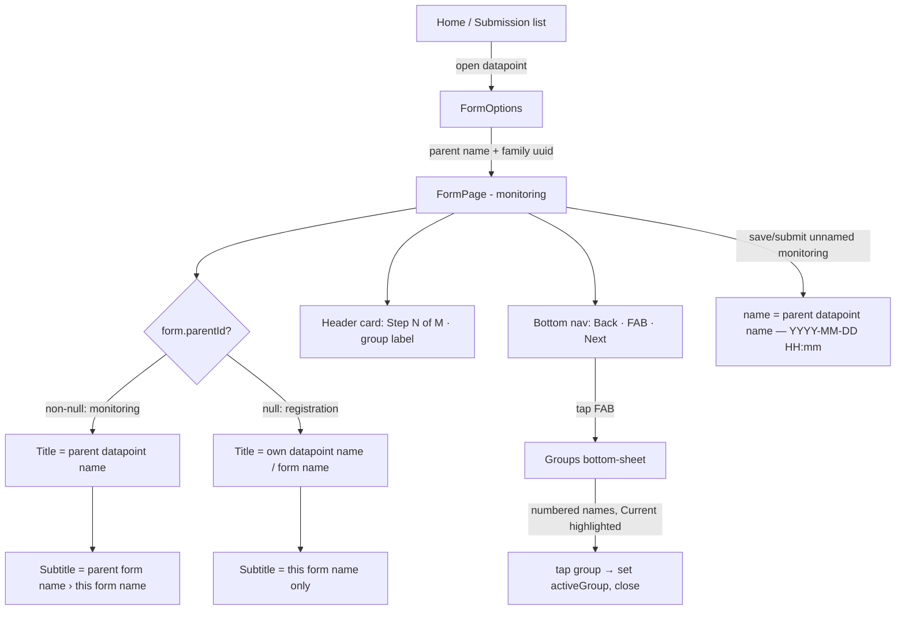

# Feature Design Document

> Planning doc for the form-page (submission) redesign — screens 15, 16, 17 of the
> mobile redesign canvas. Complete before implementation; read for context during it.

---

## Feature: Form page redesign — group navigation, header path & monitoring naming

**Task ID**: APP-598 (GitHub issue [#598](https://github.com/akvo/akvo-mis/issues/598) — "[Mobile-Redesign] - Form Submission Feedback")
**Author**: Akvo MIS mobile
**Date**: 2026-11-26
**Status**: Approved (developer)

**Design screens**: canvas "MIS app redesign" — `15 · Your form page, redesigned`
(`RealForm`), `16 · Scrolled: compact header` (`RealFormCompact`), `17 · Groups
sheet, long name` (`RealGroups`).

---

## 1. Context & Problem Statement

```
Currently:
- The form page top bar shows a static "New Submission" title (trans.newSubmissionText),
  with the form name on a second line and a "Step N of M — <group label>" indicator.
- Group navigation exists (QuestionGroupList) but is reached through a plain toggle and
  shows per-group completion ticks plus a dynamic "(filled/required)" count that changes
  as conditional questions appear/disappear — confusing for field users.
- A monitoring submission with no meta-generated name is saved and listed as "Untitled",
  losing its link to the parent datapoint it belongs to.

Goal:
- Make group names the primary way to move between groups, opened from a bottom-nav FAB.
- Count question GROUPS for progress, not dynamically-computed required questions.
- Replace the generic title with datapoint identity + a form-hierarchy breadcrumb path.
- Never show "Untitled" for a monitoring submission — derive a name from its parent.
```

This is mobile-only (React Native / Expo). No backend, API, or SQLite schema change.

---

## 2. Requirements

### User Acceptance Criteria
- [ ] Opening a **monitoring** form shows the **parent datapoint name** as the header title
      and `‹parent form name› › ‹this form name›` beneath it.
- [ ] Opening a **registration** form shows its own datapoint name — or the **form name**
      until a meta question is answered — as the title, and a single-segment path (just the
      form name), no `›`.
- [ ] A **center FAB** in the bottom nav opens a **groups bottom-sheet**; tapping a group
      jumps to it and closes the sheet; the active group is marked "Current".
- [ ] The groups sheet shows a **filled/required tally** in its header (all groups) and under
      each group row (that group, green when complete).
- [ ] Progress reads **"Step N of M" / "Group N of M"** where **M = navigable group count**,
      regardless of how many conditional questions are shown — header and sheet always agree.
- [ ] The header stays at full height (screen 15) while scrolling — **no compact variant**.
- [ ] A monitoring submission that would be "Untitled" is named
      **`‹parent datapoint name› — ‹short datetime›`** everywhere (header, lists, sync, export).

### Technical Acceptance Criteria
- [ ] Reuse `QuestionGroupList` / `FormNavigation` / `FormContainer`; no new store fields
      unless unavoidable.
- [ ] Submit-time validation (`FormNavigation.findFirstInvalidGroup`) is unchanged.
- [ ] en + fr i18n keys for every new/changed string; no hard-coded copy.
- [ ] Airbnb ESLint clean (no `for..of`, no `await`-in-loop, arrow components); lint passes
      in the `mobile` container.
- [ ] No regression to draft save / submit / monitoring prefill.

---

## 3. Data Model Changes

**No new models. No SQLite schema change.** The `datapoints.name` column already exists;
only the *value written* to it changes for unnamed monitoring submissions.

### Modified behaviour

| Area | Change | Reason |
|------|--------|--------|
| `FormPage.handleOnSaveAndExit` ([FormPage.js:275](../../app/src/pages/FormPage.js)) | `dpName \|\| trans.untitled` → `resolveDatapointName(...)` | Persist parent-derived name for monitoring drafts |
| `FormPage.handleOnSubmitForm` ([FormPage.js:329](../../app/src/pages/FormPage.js)) | same as above | Persist parent-derived name on submit |

### Data already reachable (no new queries required)
- **Is monitoring?** `FormState.form.parentId` is non-null for a monitoring form.
- **Parent form name** (path segment 1): `FormState.previousForm?.name`, set when entering a
  monitoring form from `FormOptions.goToSubmission`. Fallback: resolve via `crudForms` from
  `form.parentId` (backend formId).
- **Parent datapoint name** (title + name fallback): carried through the monitoring launch
  flow as the parent datapoint name param (`FormOptions` `route.params.name` → `subTitle`);
  if absent, resolve by family `uuid` + parent form local id via `crudDataPoints`.
- **This form name** (path segment 2): `FormState.form.name`.
- **Group count / index**: already in `FormState.totalGroup` / `FormState.activeGroup`
  (see `FormContainer` lines 104-120). `totalGroup` currently includes the Overview step
  (`questionGroupCount + 1`); the "M" shown to users must be the **question-group count**,
  not `totalGroup` (see D-6).

---

## 4. API Contract

No API changes. All data is local (SQLite + Pullstate `FormState`). The monitoring
launch route already supplies parent identity (`FormOptions.js` → `Submission` → `FormPage`).

---

## 5. Decision Log

### D-1: Header shows datapoint name as title + form path as subtitle
**Options**: (A) datapoint name title + `parent-form › this-form` subtitle; (B) path as the
title line; (C) keep type-chip + single form name as drawn.
**Decision**: A.
**Rationale**: Keeps the tappable datapoint identity (→ full-names sheet, screen 14) while
adding the hierarchy the user asked for. Registration forms collapse to a single segment.
**Impact**: `FormPage` header render; new i18n for the breadcrump separator is none (use `›`).

### D-2: Monitoring name fallback = `parent datapoint name — short datetime`, **persisted**
**Options**: display-only fallback; persist parent name; parent name + suffix.
**Decision**: Persist `‹parent datapoint name› — ‹short datetime›` into `datapoints.name`.
**Rationale**: User choice. Persisting (not display-only) keeps Manage-data lists, sync
payloads and exports consistent with what the user sees; the datetime suffix keeps repeated
monitoring rounds of the same parent distinguishable.
**Impact**: `resolveDatapointName` helper used at both save paths (FormPage.js:275, :329).
Registration submissions keep the plain `trans.untitled` fallback.

### D-3: Short datetime format
**Decision**: `YYYY-MM-DD HH:mm` (app short format), from the submission's created/submitted
time. Not localized/relative — stable and sortable in lists.
**Impact**: one formatting helper; reuse existing date utility if present.

### D-4: Group navigation via center FAB → bottom-sheet
**Options**: FAB opens groups sheet (form opens at group 1); form opens on the group list.
**Decision**: FAB opens the sheet; the form still launches at group 1.
**Rationale**: Matches the design; least disruptive to the existing fill flow. "Show only
group names" is satisfied by the sheet listing names (no inline questions).
**Impact**: Add a center FAB to `FormNavigation`; render `QuestionGroupList` as a bottom-sheet
overlay instead of a full-screen swap.

### D-5: Group rows = numbered name + "Current" + filled/required tally
**Options**: numbers only (as drawn); keep per-group completion ticks; show a filled/required
tally.
**Decision** (revised after device review): drop the per-group completed/error **icons**, but
show a **filled/required tally** in two places — the sheet header `Question groups (8/20)` across
all groups, and a per-row subtitle `filled/required` under each group name (green when that group
is complete). The active group is highlighted with a "Current" badge.
**Rationale**: The old icons + global `(filled/required)` header count were confusing, but in
testing the user wanted the concrete progress numbers back — per group and in total — as the
field user's "what's left" cue. Numbers read more clearly than ticks.
**Impact**: `QuestionGroupList` keeps `countValidRequiredQuestions`, extended to return a
per-group `groups: [{filled, required}]`. The tally is computed **only while the sheet is open**
(debounced), mirrors the submit gate (same Yup schema, dependency/entity aware). Submit-time
gating untouched.

### D-6: "M" is the navigable question-group count, not `totalGroup`
**Decision**: Progress denominator = the question-group count of the **transformed** form
(`transformForm` output), excluding the synthetic Overview step.
**Rationale**: Users count the groups they see. `transformForm` collapses/expands the raw JSON by
dependencies (e.g. 12 raw groups → 4 navigable), so the raw `formJSON.question_group.length` can
disagree with the sheet and the Next/Back flow.
**Impact**: `FormPage` reads `totalGroup - 1` from `FormState` (the same transformed count the
groups sheet and navigation use), so header card, sheet subtitle, and nav always agree. The
Overview step still exists in navigation but is not numbered as "Group N of M".

### D-7: Reuse existing components; no backend/schema change
**Decision**: Extend `FormContainer` / `FormNavigation` / `QuestionGroupList`; add a small
`resolveDatapointName` helper beside the existing name generation in `app/src/form/lib`.
**Rationale**: Ponytail — the group list, nav bar and name generation already exist; this is
a re-skin + a naming fallback, not new subsystems.

### D-8: Registration title before a name = the form name
**Decision**: For a registration submission with no generated datapoint name yet, the header
title is the **form name** (not a "New ‹form name›" placeholder).
**Rationale**: User choice; simplest, and the live generated name takes over once a meta
question is answered.
**Impact**: Title resolver falls back `generatedName → form.name` for registration.

### D-9: No compact header — screen 15 only
**Decision**: Drop the scrolled compact-header variant (screen 16). The full header (title +
path + "Step N of M" card) stays at full height while scrolling.
**Rationale**: User choice — one header state is simpler and avoids a scroll-position listener.
**Impact**: No `N/M` compact chip; progress shows only via the header card and the groups sheet.

### D-10: Header title width widened (global)
**Decision**: Bump the RNEUI `Header` center container from `flex: 2` to `flex: 4` in
`BaseLayout/PageTitle`, so long titles (datapoint names, form names) fit on one line.
**Rationale**: Device review showed "Wastewater Pump Station" / long monitoring names wrapping to
2–3 lines at the default ~50% center width. Side containers only need room for one 44dp icon.
**Impact**: Global — every screen's top-bar title gets more width.

### D-11: Groups sheet — backdrop fades, sheet slides
**Decision**: Drive the sheet with `Animated` (`Modal animationType="none"`): the dim backdrop
fades `opacity 0→1` while only the sheet `translateY`-slides up from the bottom.
**Rationale**: A single `animationType="slide"` slid the backdrop up with the sheet, leaving the
top of the screen briefly undimmed — it read as a panel, not a lightbox.
**Impact**: `QuestionGroupList` holds one `Animated.Value`, native-driven, 220ms.

### D-12: FAB centered via full-width overlay
**Decision**: Center the groups FAB with an absolute, full-width `pointerEvents="box-none"`
wrapper (`alignItems: center`) rather than `left: '50%' + marginLeft`.
**Rationale**: The percentage-offset approach drifted off-center because of the nav bar's
horizontal padding; the wrapper centers on the whole bar and still lets touches reach Back/Next.

---

## 6. Type/Constant Mappings

| Design element | Source value |
|----------------|--------------|
| Header title | parent datapoint name (monitoring) / generated datapoint name → `form.name` (registration) |
| Breadcrumb subtitle | `previousForm.name › form.name` (monitoring) / `form.name` (registration) |
| "Step N of M" | `activeGroup + 1` / (`totalGroup - 1`) |
| Groups-sheet row | `${index + 1} · ${group.label}` |
| Sheet header tally | `Question groups (${totalFilled}/${totalRequired})` |
| Sheet row tally | `${group.filled}/${group.required}` (green when `filled >= required`) |
| Monitoring unnamed name | `` `${parentDatapointName} — ${YYYY-MM-DD HH:mm}` `` |

---

## 7. Compatibility & Migration

### Backward Compatibility
- [x] Existing registration submissions unchanged (still `trans.untitled` when unnamed).
- [x] Existing monitoring rows already named keep their names; the fallback only affects
      submissions that would otherwise be "Untitled".
- [x] No migration — behaviour applies to newly saved/submitted rows going forward.

### Mobile App Impact
- [ ] Sync endpoints affected: none (name is already part of the sync payload; only its value
      differs for previously-"Untitled" monitoring rows).
- [x] SQLite schema changes: **no**.
- [x] Version detection: ships in the mobile app bump (5.0.3) — no server coordination.

### Seeder/CLI Compatibility
- [x] No seeder or CLI change.

---

## 8. Security Considerations
- [x] No new inputs, endpoints, or permissions. Parent datapoint name is already visible to
      the same user in the same workspace; composing it into a child name exposes nothing new.
- [x] No injection surface — the datetime is formatter output, the parent name is existing data.

---

## 9. Testing Strategy

| Test Type | Coverage |
|-----------|----------|
| Unit | `resolveDatapointName`: monitoring w/ parent → `parent — datetime`; monitoring w/o generated name but no parent → graceful fallback; registration unnamed → `untitled`; already-named → unchanged. Short-datetime formatter. |
| Unit | Progress denominator uses `questionGroupCount` (Overview excluded); breadcrumb builds single vs two-segment path by `parentId`. |
| Component | Groups bottom-sheet opens from FAB, lists numbered names, marks Current, jump-to-group sets `activeGroup`. |
| Manual (device) | Monitoring form header path + title; scroll → compact header; unnamed monitoring draft appears as `parent — datetime` in Manage data; registration still shows its own name. |

Note: `FormPage*.test.js` and `QuestionGroupList.test.js` will need updates where they assert
the removed ticks / `(filled/required)` count and the old title.

---

## 10. Open Questions
- [x] Registration title before any meta answer → **form name** (D-8).
- [x] Compact header → **dropped**; screen 15 header only, no scroll-collapse (D-9).

None open.

---

## 11. References
- Related: [APP-585](APP-585-home-screen-redesign.md) (home), APP-596 (submission list) — same redesign epic.
- GitHub issue: [#598](https://github.com/akvo/akvo-mis/issues/598).
- Design canvas: "MIS app redesign" — boards `RealForm`, `RealFormCompact`, `RealGroups`.
- Touch points: [FormPage.js](../../app/src/pages/FormPage.js), [FormContainer.js](../../app/src/form/FormContainer.js), [FormNavigation.js](../../app/src/form/support/FormNavigation.js), [QuestionGroupList.js](../../app/src/form/support/QuestionGroupList.js), [FormOptions.js](../../app/src/pages/FormOptions.js).

---

## Flow: monitoring form page



---

## Approval

| Role | Name | Date | Status |
|------|------|------|--------|
| Developer | Iwan Firmawan | 2026-11-26 | Approved |
| Tech Lead |  |  | — |
| Product |  |  | — |
