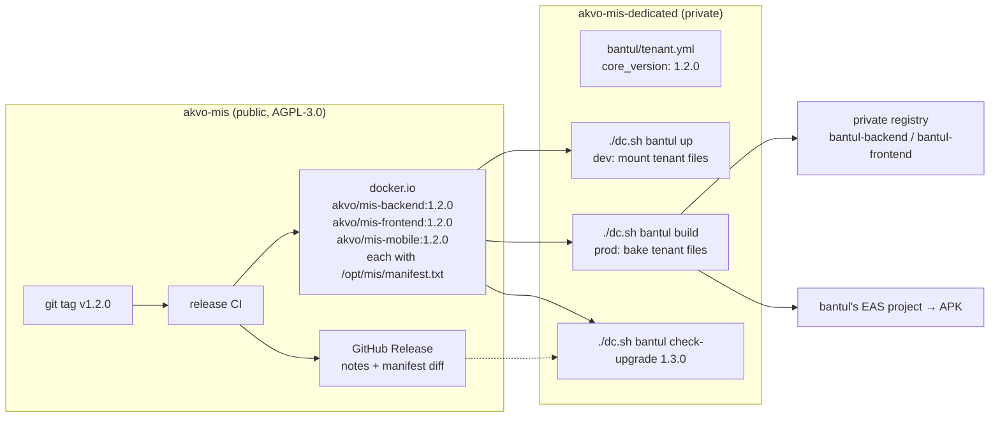
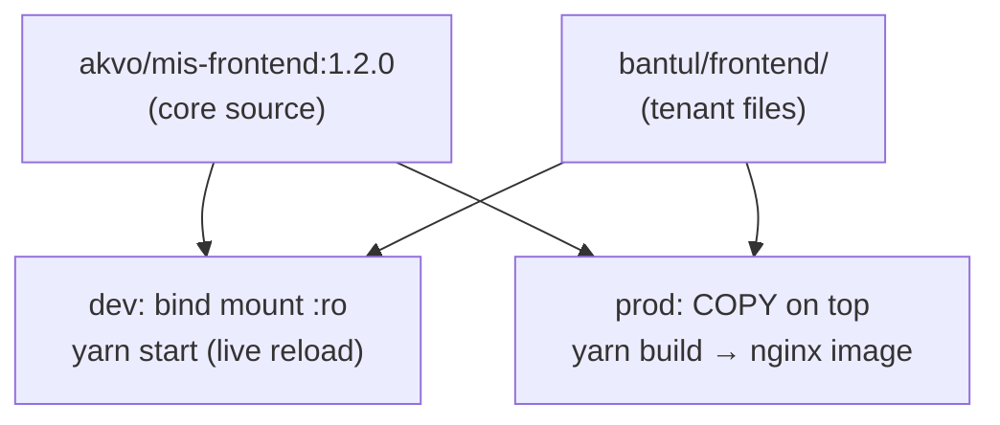
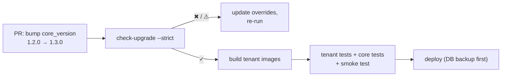

# DT-001: Dedicated Tenant Deployments — Core Support

**Task ID**: DT-001
**GitHub Issue**: [#566](https://github.com/akvo/akvo-mis/issues/566)
**Author**: dedenbangkit
**Date**: 2026-11-03
**Status**: Draft

> **Scope of this document.** This repository (`akvo-mis`, "core") does not
> host, build or know about any dedicated tenant. Its only job is to give a
> separate repository, `akvo-mis-dedicated`, the best possible base to build
> on: versioned images, a small set of stable extension slots, file
> manifests, and release notes. The dedicated repository is described here
> only as the **consumer scenario** that core must support; its own design
> belongs in that repository.

---

## 1. Context & Problem Statement

```
Currently:
- Akvo MIS runs as one multi-tenant SaaS. Every workspace runs the same code.
- Premium partners want custom functionality: their own landing page,
  styles, pages, APIs, mobile screens and branded mobile app.
- The only ways to provide that today are a fork or a long-lived branch,
  both of which stop receiving core updates without manual merging.
- Core publishes images only to a private registry (eu.gcr.io), tagged by
  commit SHA / latest-test / latest-production. No semver images exist.
- Adding one route means editing frontend/src/App.js (722 lines, 17 commits
  in 6 months); adding one Django app means editing mis/settings.py
  (19 commits in 6 months). Any tenant overriding them conflicts on almost
  every core release.

Goal:
- Core publishes versioned, source-carrying images for backend, frontend and
  mobile to docker.io.
- A separate repository layers per-tenant files on top of those images —
  mounted in development, baked into images for production.
- Core offers a few stable "slots" so most customisation is additive and
  never conflicts with core changes.
- Every core release states, file by file, what changed, so a tenant can
  check upgrade impact before bumping its pinned version.
```

### Goals

1. No tenant forks or tenant branches of `akvo-mis`.
2. Minimal, stable changes to core; no plugin framework.
3. A tenant pins an exact core version and upgrades deliberately.
4. Backend, frontend and mobile can each be customised independently.
5. Upgrade impact on a tenant is detectable from files, before upgrading.

### Non-goals

- Deciding where dedicated tenants are hosted (Compose VM, Kubernetes, …).
  The production artefact is an image; hosting is negotiable.
- Designing `akvo-mis-dedicated` internals beyond the contract it relies on.
- Runtime plugins, dynamic module loading, microservices.
- Extra Python/npm dependencies per tenant (**v1 decision: none** — new
  packages go into core).
- Expo OTA updates (stay disabled, as in core today).
- Changing the existing SaaS pipeline (GCR images, GKE deploys,
  `apk-release.yml`, `deploy-prod.yml`). The new images are an *additional*
  output.

---

## 2. Architecture Overview

Dependencies point one way: the dedicated repository depends on core images;
core never references a tenant.



What core owns vs. what the dedicated repository owns:

| Concern | Core (`akvo-mis`) | Dedicated repo |
|---|---|---|
| Source of truth for application code | ✅ | — |
| Publish versioned images + manifests | ✅ | — |
| Extension slot stubs and their contract | ✅ | fills them |
| Release notes / breaking-change notices | ✅ | reads them |
| Tenant files, compose layering, `dc.sh` | — | ✅ |
| `check-upgrade` tool | publishes inputs (manifests) | ✅ runs it |
| Tenant production images, registry, hosting | — | ✅ |
| Mobile EAS projects, signing keys, APK upload | — | ✅ |

---

## 3. Core Docker Images

Published to docker.io on every semver git tag. Tag `v1.2.0` → image tag
`1.2.0`. No `latest` tag is published for these images, so nobody can depend
on one.

| Image | Base | Contents | Used for |
|---|---|---|---|
| `akvo/mis-backend` | `python:3.12-slim-bookworm` | Python deps installed via `uv sync --locked` (**including** the `dev` group), source in `/app` | backend **and** worker (worker = same image, `python manage.py qcluster`) |
| `akvo/mis-frontend` | current Node 17 image | `node_modules` installed (`yarn install --frozen-lockfile`), source in `/app`, no `build/` | dev: `yarn start`; prod: build stage → nginx |
| `akvo/mis-mobile` | current Node 20 image | `node_modules` installed, `eas-cli`, source in `/app` | dev: Expo; build: patch config → `eas build` |

Every image carries:

```
/opt/mis/version.json   {"version": "1.2.0", "commit": "abc1234", "slot_api": 1}
/opt/mis/manifest.txt   <sha256>  <component>/<path>      # one line per source file
```

`manifest.txt` paths use the repository layout (`backend/…`, `frontend/…`,
`app/…`) so a tenant folder path maps 1:1 to a manifest entry.

**Design notes**

- **One backend image for backend + worker.** `Dockerfile.worker` differs
  from `Dockerfile` only in `CMD`. Publishing one image makes it impossible
  for a tenant's backend and worker to run different code.
- **Dev dependencies included in the backend image**, so tenant CI can run
  core and tenant tests (flake8, coverage) from the same image it deploys
  from. Cost: a larger image. See Open Questions.
- **`.dockerignore` files are required** in `backend/`, `frontend/`, `app/`
  before publishing publicly (none exist today). Exclude `.env*`,
  `storage/`, `logs/`, `tmp/`, `node_modules/`, `build/`, test APKs under
  `backend/source/*.apk`, and credentials.
- **Start scripts must not edit mountable files.** `frontend/start.sh`
  runs `sed -i` on `public/index.html` and `public/manifest.json`;
  `app/start.sh` runs `sed -i` on `app.json`, `package.json`,
  `src/build.json`. Those files are declared *not overridable* (§6.4) and
  configured through environment variables instead, so a read-only tenant
  mount never collides with an in-place edit.

---

## 4. Consumer Scenario: Dedicated Repository

This section is the contract core is designed against, not a specification
of the dedicated repository.

```text
akvo-mis-dedicated/
├── docker-compose.yml          # base services: image: akvo/mis-*:${CORE_VERSION}
├── docker-compose.prod.yml     # prod commands, tenant image names
├── dc.sh                       # ./dc.sh <tenant> up | build | check-upgrade | …
├── tools/                      # check-upgrade, mount generation, build Dockerfiles
└── bantul/
    ├── tenant.yml              # tenant: bantul / core_version: 1.2.0
    ├── docker-compose.yml      # tenant-only: env, ports, extra services
    ├── backend/dedicated/      # slot: Django app
    ├── frontend/src/dedicated/ # slot: routes, Landing, style.scss
    ├── frontend/src/pages/…    # optional replacements of core files (⚠)
    └── mobile/
        ├── src/dedicated/      # slot: screens
        ├── assets/             # icon, splash
        └── app.patch.json      # name, slug, package, EAS projectId
```

- **The tenant folder mirrors core paths.** The folder tree, not a list kept
  by hand, defines what a tenant adds or replaces.
- **`dc.sh`** reads `core_version` from `tenant.yml`, uses compose project
  name `-p <tenant>` for isolated containers/volumes/networks, and generates
  the mount list from the tenant folder (compose resolves relative paths
  from the *first* `-f` file, so hand-written mounts are error-prone).
- **Development** (`up`): tenant files mounted read-only over `/app` in the
  core images; backend and worker always receive the same backend mounts.
  Mount directories rather than single files where possible — editors that
  save by rename leave single-file bind mounts pointing at the old file.
- **Production** (`build`): the same tenant files are copied into images:

```dockerfile
# backend (also used by worker)
FROM akvo/mis-backend:1.2.0
COPY bantul/backend/ /app/

# frontend
FROM akvo/mis-frontend:1.2.0 AS build
COPY bantul/frontend/ /app/
RUN yarn build
FROM nginx:<pinned>
COPY --from=build /app/build /usr/share/nginx/html
```



---

## 5. Extension Slots (core changes)

Slots are stub files in core that tenants replace or add to. Core promises
not to change their shape except in a major version (`slot_api` bump). Each
slot costs a stub plus a few lines of wiring in core.

### 5.1 Backend: `dedicated` Django app

**Core wiring** (`backend/mis/settings.py`, next to the existing
`find_spec` pattern for optional dev apps):

```python
# Dedicated-tenant extension slot (DT-001). Absent in core and in SaaS.
if importlib.util.find_spec("dedicated"):
    API_APPS.append("dedicated")
```

**Core wiring** (`backend/mis/urls.py`):

```python
from django.apps import apps

if apps.is_installed("dedicated"):
    urlpatterns.append(
        path("api/v1/dedicated/", include("dedicated.urls")),
    )
```

**Tenant adds** `backend/dedicated/` as a normal Django app: `apps.py`,
`urls.py`, views, serializers, models, `migrations/`, `tasks.py`,
management commands, tests.

Contract:

| Rule | Reason |
|---|---|
| Tenant URLs live under `/api/v1/dedicated/` | Cannot collide with core routes, now or later |
| App label is `dedicated` (one per deployment) | One tenant per deployment; nothing to namespace |
| Tenant models may FK to core models; may **not** alter core tables | Altering core schema is a fork in disguise |
| Tenant migrations may depend on core migrations | Core does not squash/rename migrations except in a major version |
| Async work uses Django-Q `async_task("dedicated.tasks.x")` | Worker runs the same image, so the task is importable |
| Use core permission classes and tenant scoping (`utils/custom_permissions.py`, tenant-scoped managers) | Same auth and isolation as core endpoints |

The worker needs no extra wiring: it loads `INSTALLED_APPS` from the same
settings and the same image.

### 5.2 Frontend: `src/dedicated/`

**Core ships stubs** (webpack only bundles files that exist at build time, so
the file must exist in core):

```javascript
// frontend/src/dedicated/index.js — DT-001 slot, replaced by tenants.
const dedicated = {
  routes: [], // [{ path: "/bantul/report", element: <Report />, private: true }]
  Landing: null, // component rendered at "/" when showLandingPage is on
};
export default dedicated;
```

```scss
// frontend/src/dedicated/style.scss — imported last; empty in core.
```

**Core wiring**:
- `App.js`: render `dedicated.routes` before the `*` catch-all, wrapping
  `private: true` routes with the same login redirect core uses; render
  `dedicated.Landing` instead of `<Home />` at `/` when it is set.
- `index.js`: `import "./dedicated/style.scss";` after `./index.scss`, so
  tenant styles take precedence over core and antd.

**Tenant replaces** the two stub files and adds its pages and components
under `src/dedicated/`.

### 5.3 Mobile: `app/src/dedicated/`

```javascript
// app/src/dedicated/index.js — DT-001 slot, replaced by tenants.
const dedicated = {
  screens: [], // [{ name: 'BantulSurvey', component: BantulSurvey }]
  homeActions: [], // [{ label: 'Survey', screen: 'BantulSurvey' }]
};
export default dedicated;
```

**Core wiring**: `app/src/navigation/index.js` registers `dedicated.screens`
in the authenticated stack after core screens; `Home` renders
`homeActions` as entry points (otherwise custom screens are unreachable).

### 5.4 Customisation that is not a slot

Anything else is a **file replacement**: the tenant provides a file at a
core path. It works the same way, but `check-upgrade` reports it whenever
core changes that file. This is intentional — replacing core behaviour is
the expensive kind of customisation and should stay visible.

---

## 6. Mobile Customisation

### 6.1 Tenant cases

| Case | What it means | Needs a new binary? |
|---|---|---|
| Tenant uses the standard Akvo MIS app | Not possible as-is: the server URL is baked into each build (`app/src/build.*.js`) | — |
| **Branded build** | Own name, icon, splash, package ID, server URL; no code changes | Yes, per tenant |
| **Customised app (v1 target)** | Branded build + mobile slot screens and/or file replacements | Yes, per tenant |
| JS-only change after release | Would be an OTA update | v1: **yes**, OTA stays off |
| Native module / Expo plugin change | Must go through core (no extra deps in v1) | Yes |

### 6.2 What core provides

- `akvo/mis-mobile` image with source, `node_modules`, `eas-cli`.
- The `src/dedicated/` slot.
- Build-time configuration by environment and patch file, not by
  replacing `app.json` (19 commits in 6 months). The fields a tenant may
  patch: `expo.name`, `expo.slug`, `expo.android.package`,
  `expo.extra.eas.projectId`, `expo.owner`, `expo.icon`, `expo.splash.image`,
  `expo.android.adaptiveIcon.foregroundImage`. Core documents this list.
- Server and APK URLs written into `src/build.js` at build time, as
  `apk-release.yml` does today.

### 6.3 What the dedicated repository owns

- One EAS project per tenant (own `projectId`, package ID, EAS-managed
  keystore, `EXPO_TOKEN`).
- Building with EAS cloud. Docker is the build *environment*, never the
  runtime; `eas build --local` is not used (it needs the full Android
  SDK/NDK/JDK in the image).
- Uploading the APK to the tenant's own backend via
  `POST /api/v1/device/apk/upload`, so in-app update prompts point at the
  tenant's server.

### 6.4 Not overridable (configure instead)

`app/app.json`, `app/package.json`, `app/src/build.json`,
`frontend/public/index.html`, `frontend/public/manifest.json`,
`frontend/package.json`, `backend/pyproject.toml`, all lock files.
`check-upgrade` treats a tenant file at any of these paths as an error.

### 6.5 Offline data

Custom mobile screens must use the core SQLite schema and sync APIs as they
are. A tenant may not change the local schema in v1 (see Open Questions):
on-device migrations run per binary and cannot be repaired from the server.

---

## 7. Core Versioning & Release Management

- **Semver on git tags**, `vMAJOR.MINOR.PATCH`. Existing tags (`v0.3.0`)
  continue; the first release with images and slots is proposed as
  `v1.0.0`.
  - **MAJOR**: `slot_api` change, migration squash/rename, removal of a
    documented stable file, removal of an API endpoint used by mobile.
  - **MINOR**: features, new migrations, changes to non-slot files.
  - **PATCH**: fixes only.
- **Release CI** (new workflow, triggered by semver tag): build the three
  images, write `version.json` and `manifest.txt`, push to docker.io, and
  attach release assets to the GitHub Release.
- **Release notes** contain, per component:

```text
## Akvo MIS Core 1.3.0  (slot_api 1, unchanged)

### Breaking changes        (none | list + migration steps)
### Slot contract           (unchanged | what changed)
### Database migrations     v1_forms 0042, v1_data 0031
### Deprecated              components/interfaces scheduled for removal
### Files
  M  frontend/src/pages/home/Home.jsx
  R  backend/api/v1/v1_forms/views.py -> backend/api/v1/v1_forms/views/form.py
  D  frontend/src/components/Legacy.jsx
  … (from git diff --name-status v1.2.0..v1.3.0)
```

- **Stable files.** Besides the slot stubs, core tries to keep these
  low-churn and calls out every change in release notes, because tenants
  are most likely to replace them: `frontend/src/variables.scss`,
  `frontend/src/index.scss`, `frontend/src/pages/home/Home.jsx`,
  `frontend/src/components/layout/`.

---

## 8. Compatibility Checking

Core provides the inputs; the dedicated repository runs the check.

```bash
./dc.sh bantul check-upgrade 1.3.0
```

1. Read `manifest.txt` from current and target images
   (`docker run --rm akvo/mis-frontend:1.3.0 cat /opt/mis/manifest.txt`) —
   no core checkout needed.
2. Diff them → modified, added, removed paths.
3. Walk the tenant folder; classify each file as **slot**, **replace**
   (path exists in current core) or **add** (path does not).
4. Report:

| Situation | Level |
|---|---|
| Replaced file modified in core | ⚠ |
| Replaced file removed or renamed in core (override silently stops applying) | ✖ |
| Added file now also exists in core (collision) | ⚠ |
| Tenant file at a non-overridable path (§6.4) | ✖ |
| `slot_api` differs between versions | ✖ |
| Slot files only | ✓ |

```text
Current core: 1.2.0
Target core:  1.3.0   (slot_api 1 → 1)

Files changed in core: 18
Files overridden by bantul: 4
Potential conflicts: 2

⚠ frontend/src/pages/home/Home.jsx   modified in core
✖ backend/mis/urls.py                removed in core

Recommendation: Review before upgrading.
```

- Default: warn and exit 0. `--strict`: exit non-zero on ⚠ or ✖ (for CI).
- **Limitation:** file-level checks cannot detect behavioural breaks — a
  tenant `Home.jsx` that imports a core component whose props changed passes
  the check. The dedicated repository's CI must also build and smoke-test
  against the target version.
- **Later refinement (not v1):** an `overrides.lock` recording the core
  version and hash each replaced file was copied from, so the tool can say
  "changed *since you copied it*" and show the upstream diff to merge.



---

## 9. Security & Operations

- **Public core images** expose nothing new: the repository is public under
  AGPL-3.0. They must contain no secrets (`.dockerignore`, CI check for
  `.env*` and credentials in the image).
- **Tenant images contain partner code** and go to a private registry
  owned by the dedicated repository. Core never sees them.
- **Pin by digest** in tenant production (`akvo/mis-backend:1.2.0@sha256:…`)
  so a re-pushed tag cannot change what runs. Core never re-pushes a
  released tag.
- **Development mounts are read-only** (`:ro`).
- **Migrations are forward-only.** `run-prod.sh` runs `migrate` on start, so
  rolling back core means restoring the database backup taken before the
  upgrade, then redeploying the previous pin.
- **Tenant isolation**: each dedicated deployment has its own database,
  storage and secrets; the dedicated repo's `-p <tenant>` keeps local
  stacks separate.
- **Image size / startup**: production does not compile at startup; the
  frontend is compiled once in the tenant build. Development startup is
  unchanged from today (`uv sync`, `yarn install` become near no-ops because
  dependencies are already in the image).

---

## 10. Risks & Trade-offs

| Risk | Impact | Mitigation |
|---|---|---|
| Tenants replace hot core files instead of using slots | Conflicts every upgrade | Slots for the common needs; `check-upgrade` makes replacements visible |
| Slot contract too small for a real tenant | Pressure to replace big files | Add slot fields in a minor release (additive is non-breaking) |
| Behavioural breaks undetected by file checks | Broken tenant after upgrade | Build + tests + smoke against target in tenant CI |
| Core migration renamed/squashed | Tenant migrations fail | Only in a major version, announced |
| Per-tenant mobile binaries | Build and signing overhead per tenant | EAS cloud per tenant; branding via patch file, not code |
| Public images leak files | Exposure of secrets/test data | `.dockerignore` + CI content check |
| Dev deps in backend image | Larger production image | Accept for v1; split later if it matters |
| Number of tenants grows | More pipelines to run | Everything per-tenant lives in the dedicated repo; core cost stays flat |

---

## 11. Proof of Concept

Goal: prove the contract end to end with one fake tenant, `poc`.

1. Publish `0.4.0-poc` images (backend, frontend, mobile) with
   `version.json` + `manifest.txt` to a docker.io test namespace.
2. Scratch `akvo-mis-dedicated` with `dc.sh`, `docker-compose.yml`,
   `poc/tenant.yml`; `./dc.sh poc up -d` starts backend, worker, frontend, db.
3. `poc/frontend/src/dedicated/style.scss` changes header colour — visible
   in dev with live reload.
4. `poc/frontend/src/dedicated/index.js` sets a custom `Landing` and one
   private route.
5. `poc/backend/dedicated/` exposes `GET /api/v1/dedicated/hello`.
6. That endpoint enqueues `dedicated.tasks.ping`; the worker runs it.
7. `poc/mobile/`: one slot screen + `app.patch.json` (name, package, icon);
   EAS build produces an APK pointing at the PoC backend.
8. Publish `0.4.1-poc` that edits `Home.jsx` and deletes one file a PoC
   override uses; `./dc.sh poc check-upgrade 0.4.1-poc` reports ⚠ and ✖.
9. Bump `core_version`; `./dc.sh poc build` produces images that still
   carry all overrides.

Assumptions the PoC must verify:
- Mounted files under `/app/src` trigger CRA live reload in the container.
- Metro picks up `src/dedicated/` from a mount without cache issues.
- `uv sync --locked --inexact` at dev start is a no-op on the published
  image (no network, no change).
- EAS cloud build works from the `akvo/mis-mobile` image with a
  tenant-specific `projectId` and `EXPO_TOKEN`.

---

## 12. Implementation Phases (core only)

Detailed estimates come with the implementation plan.

| Phase | Work in `akvo-mis` |
|---|---|
| 1. Image readiness | `.dockerignore` files; start scripts that don't edit mountable files; single backend/worker image |
| 2. Slots | Backend (`settings.py`, `urls.py`), frontend (`src/dedicated/`, `App.js`, `index.js`), mobile (`src/dedicated/`, navigator, Home) — with tests |
| 3. Release pipeline | Semver-tag workflow → docker.io; `version.json`, `manifest.txt`; release notes with file diff |
| 4. Contract docs | Slot contract, non-overridable files, stable files, semver rules (in this repo's docs) |
| 5. PoC | §11, using a scratch dedicated repo |

---

## 13. Acceptance Criteria

### Technical
- [ ] Pushing tag `vX.Y.Z` publishes `akvo/mis-backend|frontend|mobile:X.Y.Z`
      to docker.io; no `latest` tag.
- [ ] Each image contains `/opt/mis/version.json` and `/opt/mis/manifest.txt`
      matching the tagged commit.
- [ ] Images contain no `.env*`, credentials, `storage/` or test APKs.
- [ ] With no `dedicated` app/stubs replaced, core behaves exactly as today
      (existing test suites pass; SaaS pipeline unchanged).
- [ ] A `backend/dedicated` app is installed, migrated and routed at
      `/api/v1/dedicated/` in backend and worker without editing core files.
- [ ] Replacing `frontend/src/dedicated/index.js` adds routes and a landing
      page; replacing `style.scss` overrides core styles.
- [ ] Replacing `app/src/dedicated/index.js` adds screens reachable from Home.
- [ ] Start scripts succeed when tenant files are mounted read-only.

### Consumer scenario (verified by the PoC)
- [ ] `./dc.sh <tenant> up -d` runs a tenant from published images.
- [ ] `./dc.sh <tenant> build` produces images that include tenant files.
- [ ] `check-upgrade` reports modified and removed overrides between two
      published versions.
- [ ] A tenant APK is built via EAS with its own package ID and server URL.

---

## 14. Open Questions

1. **Dev deps in the backend image** — accept the size for v1, or publish
   `mis-backend` and `mis-backend-dev`?
2. **Tenant mode inside a dedicated deployment** — single-host
   (`BASE_DOMAIN` unset) with one workspace, or multi-workspace?
3. **Frontend control-center menu** — do tenant pages need a `menu` slot
   field for sidebar entries in v1, or are routes + Landing enough?
4. **Tenant settings** — does a `dedicated` app need its own settings hook
   (e.g. `dedicated/settings.py` merged in), or are environment variables
   enough?
5. **Mobile local storage** — will any tenant need its own SQLite tables? If
   so, a slot for tenant-owned, prefixed tables is needed.
6. **First version number** — start images at `1.0.0`, or continue `0.x`
   until the slot contract has been used by one real tenant?
7. **docker.io namespace** — `akvo/mis-*` under the existing Akvo Docker Hub
   organisation (CI already logs in to Docker Hub)?
