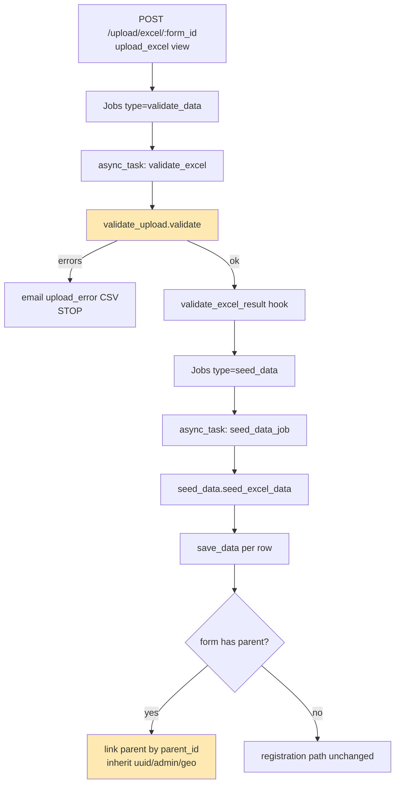

# Feature Design Document

## Feature: `parent_id` linking for bulk monitoring upload

**Task ID**: JOB-580
**Author**: Iwan Firmawan
**Date**: 2026-11-19
**Status**: Draft

---

## 1. Context & Problem Statement

```
Currently:
- The monitoring data export template emits a `parent_id` column
  (monitoring_meta_columns[1]) holding the parent registration's FormData id.
- Bulk upload (seed_excel_data) links a row to its parent ONLY by shared uuid
  (seed_data.py:247). For a new monitoring row (no data_id), the uuid is a
  fresh uuid4(), so no parent is ever found and the `parent_id` column is
  silently dropped as a non-question.
- Net effect: every bulk-uploaded monitoring row gets parent = None and is
  orphaned from its registration datapoint.

Goal:
- Honor the `parent_id` column on bulk upload so a monitoring (child-form) row
  is linked to its registration parent, inheriting the parent's uuid,
  administration and geolocation — matching the web/mobile submit path
  (serializers.py:719-731).
- Reject rows with a missing/invalid parent_id during the validate phase,
  before any data is written.
- Make the blank download template for a child form include an (empty)
  `parent_id` column + a definition-sheet hint, so users doing a FRESH bulk
  monitoring upload know the column exists and must be filled. (A blank
  template cannot auto-populate real parent ids — only the prefilled
  "Update existing" export does that, and already includes parent_id.)
```

### Template coverage (frontend `downloadTemplate`)

| Checkbox | Endpoint | Backend | parent_id |
|----------|----------|---------|-----------|
| "Update existing" ON | `GET download/generate?type=recent` | monitoring export, `monitoring_meta_columns` | present + **pre-filled** (already works) |
| "Update existing" OFF (fresh) | `GET export/form/{id}` → `export_form_data` → `blank_data_template` | `meta_columns`, form-agnostic | **absent today → this feature adds an empty column for child forms** |

Reproduction: upload `1795056983261-Short-Monitoring.xlsx` to form `1795056983261`
on the django61 instance → rows import with no parent link.

---

## 2. Requirements

### User Acceptance Criteria
- [ ] Download a monitoring template, fill answers, keep the `parent_id` column, re-upload → each row links to its registration parent.
- [ ] Download a FRESH (blank) template for a monitoring form → it contains an empty `parent_id` column, and the definition sheet explains what to put there.
- [ ] Upload a monitoring sheet whose `parent_id` is blank or points to a non-existent / wrong-form datapoint → the upload fails validation with a per-row error emailed to the uploader; nothing is imported.
- [ ] Registration (parent-less form) bulk upload — both template download and upload — behaves exactly as before.

### Technical Acceptance Criteria
- [ ] `seed_excel_data` sets `FormData.parent` from the `parent_id` column for child forms.
- [ ] A linked monitoring row inherits `uuid`, `administration` and `geo` from its parent.
- [ ] `validate()` enforces parent_id presence + existence + correct parent form when the target form has a parent.
- [ ] `blank_data_template` uses `monitoring_meta_columns` for child forms (and rearranges with the matching meta set), `meta_columns` otherwise.
- [ ] No DB migration; no new endpoint.
- [ ] `flake8` clean.

---

## 3. Data Model Changes

**None.** `FormData.parent` (self-FK, [models.py:22](../../backend/api/v1/v1_data/models.py#L22)) and `FormData.uuid` ([models.py:39](../../backend/api/v1/v1_data/models.py#L39)) already exist. No migration.

### Modified Models

| Model | Change | Reason |
|-------|--------|--------|
| — | none | Only import/validation logic changes |

---

## 4. API Contract

No new or changed endpoints. Behavior changes inside the existing async job chain for `POST /api/v1/upload/excel/{form_id}`.

| Method | URL | Purpose | Auth |
|--------|-----|---------|------|
| POST | `/api/v1/upload/excel/{form_id}` | Enqueue validate → seed job for an uploaded sheet | Required |

### Job chain (unchanged shape, changed behavior)



Yellow = the two functions this feature touches.

### Validation error example (emailed CSV, existing mechanism)

```
parent_id,error
,Parent id is required for monitoring form
99999,Parent id 99999 does not exist
1234,Parent id 1234 is not a registration of this form
```

---

## 5. Decision Log

### D-1: Link key — `parent_id` vs shared `uuid`

**Options Considered**:
1. `parent_id` (FormData id) — the column the export already emits.
2. `uuid` — reuse the existing uuid filter at seed_data.py:247.

**Decision**: `parent_id`.

**Rationale**: The uuid path is not actually cheaper. The importer never reads a uuid column — `collect_answers` derives uuid from `data_id` only ([seed_data.py:79](../../backend/api/v1/v1_jobs/seed_data.py#L79)), so uuid-linking would still require import changes *plus* a new export column *plus* a `form__parent__isnull=True` guard at line 247 (currently missing, so `filter(uuid=…).first()` could match a sibling monitoring row). Registration uuids are not surfaced to users; `parent_id` is. `parent_id` needs zero export changes and accepts the sheet users already have.

**Impact**: Changes confined to `seed_data.py` + `validate_upload.py`.

### D-2: Administration & geolocation source

**Options Considered**:
1. Inherit from parent. 2. Take from the row's own columns.

**Decision**: Inherit from parent.

**Rationale**: Mirrors the canonical submit path ([serializers.py:729-730](../../backend/api/v1/v1_data/serializers.py#L729-L730)); a monitoring datapoint belongs to the same place as its registration. Avoids divergent admin/geo between parent and child.

**Impact**: For child forms, the sheet's `administration`/`geolocation` columns are ignored; `uuid` is copied from the parent so the shared-uuid invariant holds (dashboards, mobile SQLite rely on it).

### D-3: Invalid `parent_id` handling

**Options Considered**:
1. Reject row with an error. 2. Import as orphan (parent=None).

**Decision**: Reject during `validate()`, reported like the existing `data_id` checks ([validate_upload.py:265](../../backend/api/v1/v1_jobs/validate_upload.py#L265)). Fail-closed: no partial import.

### D-4: `parent_id` on edit (row has both `data_id` and `parent_id`)

**Decision**: Ignore `parent_id` when `data_id` is present. Parent is fixed at creation; re-pointing an existing monitoring row to a different parent is out of scope. Validation of parent_id is skipped for rows that carry a valid `data_id`.

### D-5: Blank template for child forms

**Options Considered**:
1. Add an empty `parent_id` column + definition-sheet hint to the blank template for child forms.
2. Leave the blank template form-agnostic; users only ever get parent_id via the "Update existing" prefilled export.

**Decision**: Option 1.

**Rationale**: Without the column, a user building a fresh monitoring upload has no signal that `parent_id` is required and no header to fill. A blank template cannot populate real ids (there is no data yet), so the column is empty and the definition sheet carries the instruction. The prefilled "Update existing" export remains the way to get auto-filled parent_ids.

**Impact**: `blank_data_template` must pick the meta set by `form.parent_id`, and `rearrange_definition_columns` ([export_form.py:147](../../backend/utils/export_form.py#L147)) currently strips any column not in `meta_columns` — so `parent_id` would be mis-ordered as a question unless the rearrange also honors `monitoring_meta_columns` for child forms. Hint is added as a `parent_id` row in the `questions` definition sheet (e.g. label "Registration datapoint id this monitoring record belongs to").

---

## 6. Type/Constant Mappings

| Concept | Location | Value |
|---------|----------|-------|
| Monitoring sheet meta columns | [export_form.py:17](../../backend/utils/export_form.py#L17) | `["id", "parent_id", "datapoint_name", "administration", "geolocation", "created_at", "created_by"]` |
| Child-form detection | `Forms.parent_id is not None` | — |
| Parent lookup | `FormData.objects.filter(pk=parent_id, form=form.parent)` | — |

---

## 7. Compatibility & Migration

### Backward Compatibility
- [x] Registration (parent-less) uploads unaffected — new logic gated on `form.parent`.
- [x] Existing data preserved — no migration.
- [x] Export template unchanged — already emits `parent_id`.

### Mobile App Impact
- [ ] Sync endpoints affected: none
- [x] SQLite schema changes: no
- [x] Version detection: n/a

### Seeder/CLI Compatibility
- [x] Existing seeders work (`seed_excel_data` keeps registration behavior).
- [ ] New seeder commands needed: none

---

## 8. Security Considerations

- [x] **Tenant isolation (REQUIRED).** `parent_id` must reference a datapoint whose `form_id == form.parent_id`. Since a child form and its parent share one tenant ([Forms.tenant](../../backend/api/v1/v1_forms/models.py#L22)), this pins the parent to the uploading tenant's single parent form — a `parent_id` from any other tenant/form fails the check. This is the robust guard: `validate()` runs in an async django-q worker with **no request context**, so the `TenantManager` thread-local is not set and `.objects` tenant filtering cannot be relied on. The explicit `form=form.parent` filter does not depend on it.
- [x] **Admin scoping preserved.** `save_data` already rejects rows whose administration is outside the user's subtree ([seed_data.py:263](../../backend/api/v1/v1_jobs/seed_data.py#L263)). Because the child inherits the parent's administration, that same guard applies to the inherited admin — a user cannot attach monitoring data to a parent outside their scope.
- [x] Input validation specified (D-3): parent_id must be an integer, exist, and reference a registration of `form.parent` (tenant isolation above).
- [x] No new attack vectors — same endpoint, same permission (`for_user` form filter, `IsAuthenticated`).

---

## 9. Testing Strategy

| Test Type | Coverage |
|-----------|----------|
| Unit — template | `blank_data_template` for a child form includes `parent_id` column in the right position; registration form unchanged |
| Unit — validate | child-form sheet: blank parent_id → error; non-existent id → error; wrong-form id → error; valid id → no error; registration form sheet unaffected |
| Unit — seed | valid parent_id links parent + inherits uuid/admin/geo; registration upload still orphan-free; row with data_id ignores parent_id (D-4) |
| Integration | end-to-end `seed_excel_data(job, test=True)` on a monitoring sheet → FormData.parent set, uuid == parent.uuid |

Reuse the `pending()` pattern, not `expectedFailure`, and patch `utils.storage.STORAGE_PATH` to tmp per project test conventions.

---

## 10. Open Questions

- [x] **RESOLVED (required).** parent_id must not reference another tenant's datapoint. Enforced by the `form=form.parent` filter in D-3 / §8 — the parent is pinned to the uploading tenant's one parent form, and this does not rely on the `TenantManager` thread-local (unset in the async worker). No separate tenant query needed.

---

## 11. References

- Brainstorm: this task's `/sc:brainstorm` session (root cause + decisions).
- Related: [JOB-502-data-export-question-order.md](JOB-502-data-export-question-order.md), [MP-001-monitoring-data-view.md](MP-001-monitoring-data-view.md)
- Code: [seed_data.py](../../backend/api/v1/v1_jobs/seed_data.py), [validate_upload.py](../../backend/api/v1/v1_jobs/validate_upload.py), [job.py](../../backend/api/v1/v1_jobs/job.py), [export_form.py](../../backend/utils/export_form.py)

---

## Approval

| Role | Name | Date | Status |
|------|------|------|--------|
| Developer | | | |
| Tech Lead | | | |
| Product | | | |
