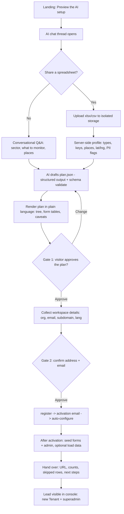

# Feature Design Document — AI-assisted Conversational Onboarding

> **Purpose**: An OpenAI-powered conversational onboarding on the public web —
> a conversion of the `akvo-mis-workspace-from-data` skill. The visitor chats
> (or drops a spreadsheet); the AI proposes a workspace plan and, after two
> approval gates, builds it through the existing provisioning. Third of three:
> **[[LP-001]]** landing · **[[LP-002]]** wizard · **LP-003 (this)** AI onboarding.

---

## Feature: AI Conversational Onboarding (phase 2)

**Task ID**: LP-003
**Author**: Iwan Firmawan
**Date**: 2026-11-11
**Status**: Review
**Estimate**: ~12h (agentic coding + heavy reuse of the skill scripts) — see
the honesty note in §8 on where this can overflow.
**Depends on**: [[LP-002]] (the onboarding container/contract), [[LP-001]] (landing)

---

## 1. Context & Problem Statement

```
Currently (after LP-002):
- The wizard creates a workspace from a fixed set of questions. It cannot look
  at a visitor's real data and design forms/places from it.
- The `akvo-mis-workspace-from-data` skill already does exactly that, but as an
  operator-run CLI: profile a spreadsheet → propose a plan in plain language →
  (two human approval gates) → register → seed forms/admin → load data.

Goal:
- Bring that skill to the public web as a chat: "Tell me what you want to
  monitor — or drop a spreadsheet — and I'll set up a working workspace."
- When a file is shared, design forms + the administration hierarchy from the
  data; otherwise hold a natural conversation. Drive the SAME provisioning as
  the wizard (register → activate → configure), preserving both approval gates.
```

### D-4: why design/build this now (not "far future")

Two facts move it from distant to feasible:
1. **The OpenAI stack already ships here.** `OPENAI_API_KEY`,
   `OPENAI_ASSISTANT_ID`, `OPENAI_VECTOR_STORE_ID` are configured
   (`env.example`), with two live patterns to reuse: `v1_chatbot/` (Assistants
   API + Vector Store) and `v1_visualization/ai/ai_service.py` (OpenAI
   **structured output against a JSON schema** + deterministic **heuristic
   fallback** behind a **`CircuitBreaker`**). This is a new consumer of the same
   stack, not a new stack.
2. **The skill scripts are reusable almost wholesale** (see §6).

It is still a separate, later increment because the **public file-upload + PII
surface** is genuinely new and risky.

---

## 2. Requirements

### User Acceptance Criteria
- [ ] From the landing "AI assistant" entry, the visitor opens a chat that sets
      up a workspace.
- [ ] The visitor can either upload a spreadsheet **or** just describe what they
      want to monitor (no file required).
- [ ] The assistant proposes a plan in plain language (forms, places, record
      counts) and the visitor must **approve the plan (gate 1)** and **confirm
      the workspace address + email (gate 2)** before anything is created.
- [ ] After approval + activation, the workspace is built with forms, places
      and (if a file was shared) records; the visitor gets the URL and a summary.

### Technical Acceptance Criteria
- [ ] Reuses the OpenAI client/config and the structured-output + CircuitBreaker
      pattern; no second AI stack.
- [ ] Reuses the skill's `profile_data.py`, `render_plan.py` and `mis.py`
      command functions (§6).
- [ ] Provisioning runs only after both gates and drives the EXISTING
      register/activate/configure + seed/load endpoints. Idempotent.
- [ ] Every public endpoint carries Turnstile + rate limits; uploaded files go
      to isolated, short-retention storage; spreadsheet/chat content is treated
      as data, never instructions (prompt-injection safe).
- [ ] Backend passes `flake8`; frontend passes eslint.

---

## 3. Flow (the skill's gates on a public chat)



The two gates are the skill's non-negotiable rule ("nothing is written to a
server until the user approved the rendered plan and confirmed address +
email") — load-bearing because a wrong subdomain or form cannot be deleted
through the API.

---

## 4. API Contract (new backend surface)

| Method | URL | Purpose |
|--------|-----|---------|
| POST | `/api/v1/onboarding/ai/message` | Send a turn; returns assistant reply + state (`collecting`, `plan_ready`, `awaiting_gate1`, `awaiting_gate2`). |
| POST | `/api/v1/onboarding/ai/upload` | Upload a spreadsheet to isolated, short-lived storage; returns a profile summary. Turnstile + size/type caps + rate limit. |
| POST | `/api/v1/onboarding/ai/plan` | Return the current `plan.json` rendered as plain language for gate 1. |
| POST | `/api/v1/onboarding/ai/provision` | Only valid after both gates: drive register → (activation) → configure → seed forms/admin → optional load-data. Idempotent. |

Seeding/loading reuses the existing form-seeder and data endpoints the skill
already targets — not new write paths into tenant data.

---

## 5. Reuse the existing OpenAI infra — do not build a new stack

| Need | Reuse |
|------|-------|
| LLM client, key management | `OPENAI_*` in `settings.py` / `env.example`. |
| Multi-turn conversation + grounded KB | `v1_chatbot/` (Assistants API + Vector Store, thread-per-conversation). The onboarding bot is a **dedicated second Assistant** (own system prompt + "how Akvo MIS models data" KB), not the support chatbot reused — see §12 Q1. |
| Free input → validated structured object | `v1_visualization/ai/ai_service.py` — structured output against a JSON schema + heuristic fallback behind a `CircuitBreaker`. The "design a plan" step produces a `plan.json` validated against the skill's `plan-format`; fall back to rule-based mapping if the model misbehaves or the breaker is open. |

New code is an **orchestration layer** (`v1_onboarding/ai_*`), not a new AI
integration.

---

## 6. Reuse the skill scripts (the big time-saver)

Branch `feature/461-workspace-from-spreadsheet-skill`,
`skills/akvo-mis-workspace-from-data/scripts/`:

| Script | What it gives us | Maps to |
|--------|------------------|---------|
| `profile_data.py` (stdlib + pandas) | Column type inference, registration keys, nested places, lat/lng, PII flags, spelling variants → JSON profile | C3 (wrap as a module) |
| `render_plan.py` | Validates `plan.json` against the data + renders it in plain language (the gate-1 content) | C4 (validation/render) |
| `mis.py` (stdlib HTTP) | `cmd_register / cmd_activate / cmd_login / cmd_configure / cmd_seed_admin / cmd_seed_forms / cmd_load_data`, all **idempotent**, already targeting the HTTP API; plus value converters (`to_number/to_date/to_geo/match_option`) | C6 (provisioning) |

So the provisioning endpoints themselves (register/activate/configure, seed,
load) **already exist** and `mis.py` already knows how to drive them. What is
genuinely new is the thin web layer: upload (C2), conversation (C5), and the
LLM plan-generation (C4's AI part).

---

## 7. Seams already left by [[LP-002]]
- The onboarding container owns orchestration; the AI chat is a second driver of
  the same "collect → provision" contract.
- Provisioning is a function of collected answers, called with a plan-derived
  payload here.
- No lead storage to retrofit; if structured qualification (sector, problem,
  data profile) is ever wanted, add a dedicated column/table then.

---

## 8. Security, Risk & the Estimate

**Risks (why this is its own increment):**
- **Public file upload + PII.** Untrusted spreadsheets with personal data:
  isolated storage, explicit consent, the skill's `PERSONAL DATA?` gating, short
  retention, never into tenant DB without confirmation.
- **Cost / abuse.** LLM calls + file processing on an unauthenticated endpoint:
  Turnstile, per-IP/session rate limits, a token/cost ceiling, and the
  CircuitBreaker's degraded (heuristic) mode.
- **Irreversibility.** No API tenant delete → the two gates are load-bearing.
- **Prompt injection.** Spreadsheet cells and chat input are untrusted — data,
  never instructions, in every prompt.

**Honesty note on the ~12h estimate:** 12h is achievable *only* with full reuse
(§6) and with abuse/cost controls + tests folded into the task Tech ACs rather
than as separate lines. The least-compressible parts are **C4 (LLM prompt
iteration)**, **C2 (public upload security)** and **C6 (`mis.py` → in-process
refactor)**; if any of these hits friction the realistic range is **12–20h**.
Treat 12h as the optimistic/reuse-maximised figure, not a guarantee.

---

## 9. Testing Strategy

| Test | Coverage |
|------|----------|
| Unit (backend) | Profiler wrapper (reuse skill tests); plan schema validation; gate enforcement (no provision before both gates). |
| Unit (frontend) | Chat state machine; upload states; graceful CircuitBreaker-degraded rendering. |
| Integration | Upload → profile → plan → approve → provision against a local stack; idempotent re-run; prompt-injection payloads treated as data. |

---

## 10. References
- [[LP-001]], [[LP-002]] (the container/contract this plugs into).
- Prior art: `akvo-mis-workspace-from-data` skill
  (`feature/461-workspace-from-spreadsheet-skill`) — the scripts in §6.
- Reuse: `backend/api/v1/v1_chatbot/`, `backend/api/v1/v1_visualization/ai/`.
- Prototype: the AI chat demo in `LP-001-landing-design-brief.md` (port to React).
- **Live prototype (for review):** <https://claude.ai/artifact/FzcaWS4DNkPuVj3hmxHyZh>
  — open the AI setup via "Preview the AI setup". ⚠️ Keep this link private
  (restricted via the artifact's Share menu).

---

## 11. Task Breakdown · **~12h** (optimistic/reuse-maximised; see §8)

Abuse/cost controls + tests are folded into each task's Tech AC to fit 12h; if
tracked separately add ~4h. All tasks ≤8h.

**C1 · `v1_onboarding` app + AI service wrapper — 1h**
- Tech AC: new Django app; OpenAI client from `settings`; reuse structured-output
  + CircuitBreaker pattern from `v1_visualization/ai`.

**C2 · Public spreadsheet upload endpoint — 2h** *(new)*
- User AC: visitor uploads xlsx/csv and gets a profile summary.
- Tech AC: `POST /onboarding/ai/upload`; type/size caps; isolated short-retention
  storage; Turnstile + per-IP rate limit; safe parsing.

**C3 · Data profiler (reuse `profile_data.py`) — 1h**
- Tech AC: wrap the skill's profiler as an importable module; returns JSON
  profile; fully offline.

**C4 · Plan generation (AI) + validate/render (reuse `render_plan.py`) — 3h**
- User AC: assistant proposes a plan in plain language.
- Tech AC: OpenAI JSON-schema output → `plan.json` validated via the skill's
  `plan-format`/`render_plan`; heuristic fallback when model/breaker fails.
  *(LLM prompt iteration — least compressible.)*

**C5 · Conversation endpoint + state machine (incl. no-upload path) — 2h** *(new)*
- User AC: visitor can set up purely by chatting, no file.
- Tech AC: `POST /onboarding/ai/message`; thread state
  (`collecting/plan_ready/awaiting_gate1/awaiting_gate2`); both gates enforced
  server-side.

**C6 · Gate-guarded provisioning (reuse `mis.py` cmd_*) — 1.5h**
- User AC: after approval + activation, the workspace is built with forms,
  places and records.
- Tech AC: extract `mis.py`'s step logic into an **in-process service** that
  calls the existing DRF views/serializers directly (not loopback HTTP — see
  §12 Q2); idempotent; drives existing register/configure/seed/load; honors
  "no API delete".

**C7 · Frontend AI chat (port demo → real calls) — 1.5h**
- User AC: live conversational onboarding on the landing page.
- Tech AC: wire the upload/plan/chat/provision endpoints; Turnstile; graceful
  CircuitBreaker-degraded state.

**Total: ~12h** (C8 abuse/cost hardening + extra tests folded into C2/C5/C6/C7;
break out ~4h more if tracked separately).

**Dependencies:** C1 → (C2, C3, C4, C5) → C6 → C7.

---

## 12. Open Questions (resolved)

- [x] **Q1 · One assistant or a dedicated onboarding assistant?** RESOLVED: a
      **dedicated second OpenAI Assistant** for onboarding, separate from the
      `v1_chatbot` support bot. Different job (design a workspace, emit a
      `plan.json`), different system prompt, different grounding ("how Akvo MIS
      models data" vs product-help docs), different output schema. Reusing the
      support assistant would entangle two prompts and two KBs; a second
      Assistant on the same account/stack is cheap and keeps the support bot
      untouched.
- [x] **Q2 · Provision via loopback HTTP (like `mis.py`) or in-process?**
      RESOLVED: **in-process service calls.** Port `mis.py`'s step logic
      (conversion, idempotency, ordering) into a `v1_onboarding` service that
      calls the existing DRF views/serializers directly. Avoids HTTP-to-self
      auth/session loopback, is faster, and allows transaction control in the
      same process. `mis.py` stays the reference/standalone CLI; the web path
      does not shell out to it.
- [x] **Q3 · Where does the grounding KB come from?** RESOLVED: a short,
      curated "how Akvo MIS models data" note (the skill's modelling rules +
      `plan-format`), uploaded once to a Vector Store at deploy — same
      mechanism `v1_chatbot` already uses for its PDF KB. Not the full product
      docs. (Build task folded into C1.)

> LP-001 and LP-002 carry no remaining open questions; all were resolved in
> their own §10/§9.

---

## Approval

| Role | Name | Date | Status |
|------|------|------|--------|
| Developer | Iwan Firmawan | 2026-11-11 | Approved |
| Tech Lead | | | |
| Product | | | |
