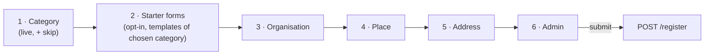

# Feature Design Document — Starter Forms from the Form Library during Onboarding

> **Purpose**: Let the [[LP-002]] onboarding wizard surface Form Library
> ([[FB-018]]) templates relevant to what the visitor wants to monitor, let them
> pick which they want, and auto-create those forms in the new workspace so it is
> usable the moment they activate. Design over two existing systems — **no new
> provisioning path, no new copy logic**.

---

## Feature: Onboarding Starter Forms

**Task ID**: LP-004 (provisional — renumber to the real issue when filed)
**Author**: Iwan Firmawan (with Claude)
**Date**: 2026-11-21
**Status**: Implemented (2026-11-21). T1–T6 done and verified (backend: 13 new
tests + register/configure suites green, flake8 clean; frontend: Onboarding
step-machine + i18n parity tests green, eslint clean). **Post-implementation UX
refinements (2026-11-23)**: the starter-forms step **auto-skips** when its
category has no templates (or the visitor picks "skip"), the wizard then
**renumbers** to a contiguous 1..5 of 5 (not a confusing "3 of 6" with a phantom
step 2), and the onboarding **draft is cleared on completion**; a new
`Activate.test.js` case covers place → root administration unit → `/control-center`.
T5 took in the **whole**
wizard, not just the new strings: the wizard chrome (hardcoded English as-built,
since LP-002 B6 never migrated it) moved to an `onboarding` namespace in the
global i18n library (`lib/i18n/<locale>/onboarding.json`, read with
`useTranslation("onboarding")`, en fallback), so the entire wizard is now
en/es/fr.
**Depends on**: [[LP-002]] (wizard, two-phase register/configure, `Tenant.meta`,
public read-only endpoint precedent), [[FB-018]] (`FormCategory`, `meta.template`,
`clone_family`, `library_registration_qs`), [[LP-001]] (public shell, scoped
Tailwind).

---

## 1. Context & Problem Statement

```
Currently:
- The LP-002 wizard asks "What do you want to monitor?" (step 1) as a hardcoded
  5-option sector list, stored in Tenant.meta.sector for sales context only.
  Nothing is created from it.
- FB-018 ships a curated Form Library: published, tenant-less template families
  tagged with runtime FormCategory rows. clone_family(registration, user) copies
  a family into a caller's tenant as drafts. But a visitor only reaches it after
  login, from inside the form builder.
- A brand-new workspace therefore lands with an empty form builder; the sector
  the visitor just picked does nothing.

Goal:
- Drive step 1 from the live library categories, show the matching templates right
  after it (step 2), and clone the ones the visitor ticks into the new tenant at
  /register/configure — so activation lands them in a workspace that already has
  their starter forms (as drafts to review and publish).
```

---

## 2. Resolved Decisions (the four forks + the six open questions)

Design proceeds on these; each is reversible and flagged where product may differ.

| Ref | Decision | Rationale |
|-----|----------|-----------|
| **R1** | Step 1 renders the **live published categories** (replacing the static 5 sectors), plus a **"Something else / skip"** tile. | One vocabulary with the library; the wizard shows real, curator-maintained categories. |
| **R2** | Forms are cloned **at `/register/configure`**, server-side, reusing `clone_family`. | Only post-activation is there a session + tenant superadmin with `form_create`. `POST /register` is anonymous. |
| **R3** | The template step is **opt-in — templates listed unchecked**. Skipping = empty workspace (intended). | No surprise forms; the visitor chooses. |
| **R4** | A **new public read-only endpoint** feeds categories + published-template **names/counts** to the pre-auth wizard. | Pre-auth visibility without the login-gated FB-018 browse and without exposing schema. |
| **D-1** (OQ1) | **Single-select** category in step 1. | Smallest change to the existing single-select sector step; multi-select is a cheap later extension. |
| **D-2** (OQ2) | **Synchronous** cloning at configure, **capped at ≤ `MAX_STARTER_FORMS` (10)** selected templates. | Reuses `clone_family` directly; the cap bounds request latency. `# ponytail:` move to a django-q job only if measured latency on large families hurts. |
| **D-3** (OQ3) | Clones land as **drafts** (FB-018 default). | Publishing stays a deliberate workspace action; a draft is reviewable first. |
| **D-4** (OQ4) | `Tenant.meta` stores **`category` + `template_ids`**; the old **`sector` key is retired** (superseded by `category`). | Categories replace sectors as the "what problem" context. Any console/sales display of `meta.sector` moves to `meta.category.name` (§6). |
| **D-5** (OQ5) | Only **categorised** published templates appear; uncategorised templates are **not** surfaced in the wizard (v1). | Curators categorise library templates (FB-018 inline category editing). No "all/uncategorised" bucket in v1. |
| **D-6** (OQ6) | Caps: **`template_ids` ≤ 10**; the endpoint returns all published templates per category (dozens max by FB-018 scale). | Bounds the clone loop and the register payload. |

---

## 3. Data Model Changes

**None.** No migration. The design is pure reuse:

- `Tenant.meta` (JSON, already added in LP-002) gains two keys written through the
  **existing bounded** `RegisterSerializer.meta` path:

  ```jsonc
  // Tenant.meta  (bounded: ≤25 keys, ≤4096 bytes — RegisterSerializer)
  {
    "category":   { "id": 4, "name": "WASH", "slug": "wash" }, // replaces "sector"
    "template_ids": [901, 905],                                // ≤ 10 ints
    "org": "Rural Water Trust", "place": "Kenya", "adminName": "…"
  }
  ```

- `Forms` / `FormCategory` — unchanged (FB-018). The library query already selects
  published tenant-less registration templates.
- Cloned forms are ordinary tenant-scoped draft `Forms` created by `clone_family`
  — no schema impact, no mobile/SQLite impact.

> **Retiring `meta.sector`**: new workspaces write `meta.category` instead. Old
> workspaces keep `meta.sector`; any reader displays `meta.category.name or
> meta.sector` during the transition (§6). No backfill.

---

## 4. API Contract

One new read; two existing endpoints extended at the edges. **No new write
endpoint**, **no new tenant-creation path**.

| Method | URL | Purpose | Auth |
|--------|-----|---------|------|
| **GET** | `/api/v1/register/form-library` | **New (read-only).** Categories each with their published templates (names + monitoring counts) for the pre-auth wizard. | Public (rate-limited, cacheable) |
| POST | `/api/v1/register` | **Existing.** `meta` now also carries `category` + `template_ids` (bounded, §4.2). | Public |
| POST | `/api/v1/register/configure` | **Existing.** After configuration, clones `meta.template_ids` into the new tenant (§4.3). Signature unchanged. | Session |

### 4.1 `GET /register/form-library`

Read-only projection over `library_registration_qs()` grouped by `FormCategory`.
Returns **only** names/ids/counts — never question structure.

```jsonc
// 200
{
  "categories": [
    {
      "id": 4, "name": "WASH", "slug": "wash",
      "templates": [
        { "id": 901, "name": "JMP Core WASH Household", "monitoring_count": 1 },
        { "id": 905, "name": "Water Point Mapping",     "monitoring_count": 0 }
      ]
    },
    { "id": 7, "name": "Agriculture", "slug": "agriculture", "templates": [ … ] }
  ]
}
```

- Source query: `library_registration_qs()` (published, tenant-less, registration
  roots) joined to `categories`; `monitoring_count` = published children count.
- Categories with **zero** published templates are **omitted** (nothing to pick).
- Caching: the catalogue changes rarely; cache with a short TTL / low-rate throttle
  like the LP-002 subdomain helper. No tenant data, so no isolation concern.

### 4.2 `POST /register` — `meta` extension

`meta` stays a single bounded `JSONField` (serializer: `META_MAX_KEYS=25`,
`META_MAX_BYTES=4096`). **Add one shape check** in `validate_meta` (or a small
helper): if `meta.template_ids` is present it must be a **list of positive ints,
length ≤ `MAX_STARTER_FORMS` (10)**, else 400. `meta.category`, if present, is a
small object (`{id, name, slug}`) — covered by the existing size bound. The view
stores `meta` on `Tenant.meta` unchanged.

> Register does **not** clone (anonymous, no tenant superadmin). It only *records*
> the choice. The ids are re-validated at configure (§4.3), so a tampered payload
> is harmless.

### 4.3 `POST /register/configure` — clone step

After the existing config transaction commits (level-0 + root unit + org + admin
name), `configure_project` performs the clone, **outside** that transaction so a
clone failure cannot roll back configuration:

```
ids        = user.tenant.meta.get("template_ids", [])[:MAX_STARTER_FORMS]
templates  = library_registration_qs().filter(pk__in=ids)   # re-validate (FR-5)
created = 0
for tpl in templates:                      # skips any id that isn't a published template
    try:
        clone_family(tpl, user=user)       # FB-018 reuse: re-tenants to user.tenant, drafts
        created += 1
    except Exception:
        logger.exception("starter-form clone failed", …)   # non-fatal (NFR resilience)
# response unchanged; optionally include {"starter_forms_created": created}
```

- **Security (FR-5)**: `library_registration_qs()` is the gate — only published,
  tenant-less registration templates survive the filter, so arbitrary ids are
  silently dropped. `clone_family` re-tenants every copy to `user.tenant`.
- **Idempotency**: configure is single-shot (`tenant_is_configured` guard at the
  top, [views.py:696](backend/api/v1/v1_users/views.py#L696)), so clones run once.
- **Trust**: ids are read from **`user.tenant.meta`** (server-side, bounded at
  register), not from the configure request body — the client cannot inject new
  ids at configure time.

---

## 5. Component / Frontend Design

`frontend/src/pages/onboarding/Onboarding.jsx` only (plus its i18n JSON).

### 5.1 Step machine

`INPUT_STEPS: 5 → 6`. New flow (starter-forms step inserted at position 2, right
after the category it depends on; submit stays on the final Admin step — OQ3):



- **Step 1 (changed)**: options come from the `GET /register/form-library`
  response fetched once on mount (store in state). Each category is a tile (single-
  select, D-1), plus a **"Something else / skip"** tile. Selecting a category sets
  `data.category`; skip sets `category = null`.
- **Step 2 (new)**: if a category is chosen, list that category's `templates`
  (name + "+N monitoring" badge) as **unchecked** checkboxes (R3) → `data.template_ids`.
  **When the chosen path offers no templates** (the "Something else / skip" tile,
  or a category with none) the step is **auto-skipped** — `advance`/`back` jump
  straight between step 1 and step 3 — rather than showing a dead empty screen
  with only a Continue button. (The empty-state copy remains as a defensive
  fallback in case the step is ever reached directly.) Placing it here (right
  after the category it depends on) keeps the two library-driven steps together;
  the core org/place/address/admin funnel then runs uninterrupted to the
  **submit on step 6 (Admin)**.
- **Step numbering follows the real path (as built)**: `INPUT_STEPS = 6`, but a
  derived `displayStep`/`totalSteps` collapse the skipped step, so when step 2 is
  auto-skipped the UI reads a contiguous **1..5 of 5** instead of jumping "Step 1"
  → "Step 3 of 6" with a phantom step 2. The internal `step` index (which drives
  rendering and the submit check) is unchanged; only the label and progress bar
  use the derived values.

### 5.2 State, draft, payload

- `EMPTY` gains `category: null, template_ids: []` (drop `sector`). Draft
  autosave/resume (`DRAFT_KEY`) carries them (FR-8). The draft is **cleared on
  completion** — in the register `.then` and, as a guard against a trailing
  autosave resurrecting it, via a dedicated effect when the done screen (step 7)
  renders.
- `submit()` payload `meta` becomes:
  `{ category: data.category, template_ids: data.template_ids, org, adminName, place }`.
- The wizard pre-fills `/register/configure` exactly as today (org/place/admin);
  **no template field is sent to configure** — the backend reads ids from
  `Tenant.meta` (§4.3).

### 5.3 Fetch + i18n

- One `api.get("register/form-library")` on mount; tolerate failure (empty →
  step 1 falls back to the skip-only state so onboarding never dead-ends, FR-1).
- The whole wizard chrome (step prompts, labels, buttons, validation messages,
  the step-2 template badges / empty state / skip tile) lives in the `onboarding`
  namespace of the global i18n library — `lib/i18n/<locale>/onboarding.json`, read
  with `useTranslation("onboarding")`, **en** default/fallback. (As built this
  also migrated the pre-existing LP-002 wizard copy, which was hardcoded English.)
  Category and template **names are data**, not translated here.

---

## 6. Compatibility & Migration

- [x] `register` / `activate` / `configure` **signatures unchanged**; `configure`
      adds an internal post-commit step only.
- [x] Direct `/register` unaffected (sends no `template_ids`; configure clones
      nothing).
- [x] No DB migration, no mobile/SQLite impact, seeders/CLI unchanged.
- [x] `meta.sector` → `meta.category`: readers display `meta.category?.name ||
      meta.sector` during transition (console tenant detail / any sales view). Grep
      `meta.sector` / `meta["sector"]` before implement; no data backfill.
- [x] Depends on FB-018 being merged (provides `clone_family`,
      `library_registration_qs`, `FormCategory`, seeded categories).

---

## 7. Security Considerations

- [x] **New endpoint is read-only & public** — rate-limited + cacheable like the
      LP-002 availability helper; returns only catalogue names/ids/counts (no
      schema, no tenant data). Templates are already a cross-tenant public
      catalogue by FB-018 design.
- [x] **Tamper-proof selection** — configure re-validates every id through
      `library_registration_qs()` and reads ids from server-side `Tenant.meta`, so
      no arbitrary or cross-tenant form can be cloned (FR-5). `clone_family`
      re-tenants to the caller.
- [x] **Bounded input** — `template_ids` length-capped at register (≤10) and at
      configure (`[:MAX_STARTER_FORMS]`); `meta` stays within the existing
      25-key/4 KB bound.
- [x] **No new write path / no weakened verification** — cloning happens only for
      an activated, session-authed superadmin in their own tenant; Turnstile +
      email activation unchanged (LP-002 D-2).
- [x] **Resilience** — clone runs outside the config transaction and is per-template
      try/except; a failure logs and is skipped, never failing `/configure`.

---

## 8. Testing Strategy

| Test | Coverage |
|------|----------|
| Unit (backend) | `GET /register/form-library`: groups published templates by category; omits empty categories; excludes drafts, monitoring children, workspace forms; returns counts not schema. |
| Unit (backend) | `validate_meta`: accepts `template_ids` list ≤10 ints; rejects non-list / non-int / >10; `meta` size/key bounds still enforced. |
| Integration (backend) | configure with `meta.template_ids=[valid, invalid, draft]` → only the valid published template family cloned into the tenant (new ids, `status=draft`, children re-pointed, `import_count+1`); invalid/draft ids skipped; response 200. |
| Integration (backend) | configure clone failure (simulate `clone_family` raise) → configuration still succeeds, workspace configured, 200. (`HTTP_HOST` override per CLAUDE.md.) |
| Integration (authz/isolation) | A `template_id` pointing at another tenant's form is skipped (not a library template); nothing cloned cross-tenant. |
| Unit (frontend) | Step machine 1→6 + resume; step-1 options rendered from fetched categories; opt-in checkboxes default unchecked; `meta` payload shape. |
| Unit (frontend) | **Skip / empty category auto-advances past the starter-forms step and renumbers to "of 5"** (contiguous, no phantom step 2); a category with templates keeps "of 6". (`Onboarding.test.js`) |
| Unit (frontend) | Onboarding auto-configures from `meta.place`: the `register/configure` POST carries `root_unit_name = meta.place` + `level_0_name = "Country"`, and lands on `/control-center`. (`Activate.test.js`) |
| Unit (frontend) | `register/form-library` fetch failure → step 1 degrades to skip-only; wizard still completes. |
| E2E | Pick category → tick 1 template → finish → activate → configure → control center shows the draft registration (+ its monitoring form). |

---

## 9. Task Breakdown (for `/sc:implement` / `/sc:workflow`)

| # | Task | Notes | Status |
|---|------|-------|--------|
| **T1** | `GET /register/form-library` endpoint + throttle + inline names/counts projection | reuses `library_registration_qs`; throttled read, no cache yet (`# ponytail:`); mirrors `register_subdomain`. `FormLibraryEndpointTestCase`. | ✅ done |
| **T2** | `RegisterSerializer.validate_meta` — `template_ids` shape/length check + `MAX_STARTER_FORMS = 10` | rejects non-list / non-int / bool / non-positive / >10. `RegisterMetaTemplateIdsTestCase`. | ✅ done |
| **T3** | `configure_project` — post-commit `_clone_starter_forms` (re-validate via library qs + `clone_family`, per-template try/except, outside the config txn) | `ConfigureClonesStarterFormsTestCase` incl. failure path. | ✅ done |
| **T4** | Onboarding.jsx — step 1 data-driven (+ skip), new step 2 (opt-in templates, right after category), `category`/`template_ids` draft+payload, fetch-fail degrade to skip-only, ≤10 select cap | eslint clean; `Onboarding.test.js`. | ✅ done |
| **T5** | Wizard i18n (en/es/fr) | Migrated the **whole** wizard chrome (not just the new step-2 strings) into the `onboarding` namespace — `lib/i18n/<locale>/onboarding.json`, `useTranslation("onboarding")`, en fallback; `i18n.test.js` parity extended to it. | ✅ done |
| **T6** | `meta.sector` → `meta.category` reader updates + grep sweep | **no-op** — grep found no reader of `meta.sector` (it was write-only sales context, never displayed). `meta.category` flows through the existing full-`meta` passthrough unchanged. | ✅ done (no change) |

**Dependencies**: T1 → T4; T2 → T3; T1/T2/T3 backend independent of T4/T5
frontend; T6 after the schema of `meta.category` is fixed (T2/T4).

---

## 10. Open Questions — resolved 2026-11-21

- **Multi-select categories in step 1?** → **No, single for v1** (confirms D-1).
  Multi-select stays a cheap later extension.
- **Auto-publish starter forms?** → **No, clones land as drafts** (confirms D-3).
  Publishing stays a deliberate workspace action; a draft is reviewable first.
- **Template step earlier?** → **Yes — moved to step 2, right after the category**
  it depends on (§5.1 / §1 updated). Org/place/address/admin follow and submit
  stays on the final step, so the core funnel is still uninterrupted.

---

## 11. References

- [[LP-002]] — wizard, `Tenant.meta`, `ConfigureSerializer`, public endpoint
  precedent, i18n, "collect → provision" seam for [[LP-003]].
- [[FB-018]] — `clone_family` ([form_library.py:47](../../backend/api/v1/v1_forms/services/form_library.py#L47)),
  `library_registration_qs`, `FormCategory`, `meta.template`, `import_count`.
- Code touchpoints: `frontend/src/pages/onboarding/Onboarding.jsx`;
  `backend/api/v1/v1_users/{views.py:694 (configure), :538 (register), :488
  (subdomain)}`; `backend/api/v1/v1_users/serializers.py:1193 (RegisterSerializer),
  :1156 (ConfigureSerializer)`; `backend/api/v1/v1_users/urls.py`;
  `backend/api/v1/v1_forms/services/form_library.py`.
- `MT-006-two-phase-registration.md`, `MT-029-signup-and-auth-abuse-hardening.md`.

---

## Approval

| Role | Name | Date | Status |
|------|------|------|--------|
| Developer | Iwan Firmawan | 2026-11-21 | Draft |
| Tech Lead | | | |
| Product | | | |
