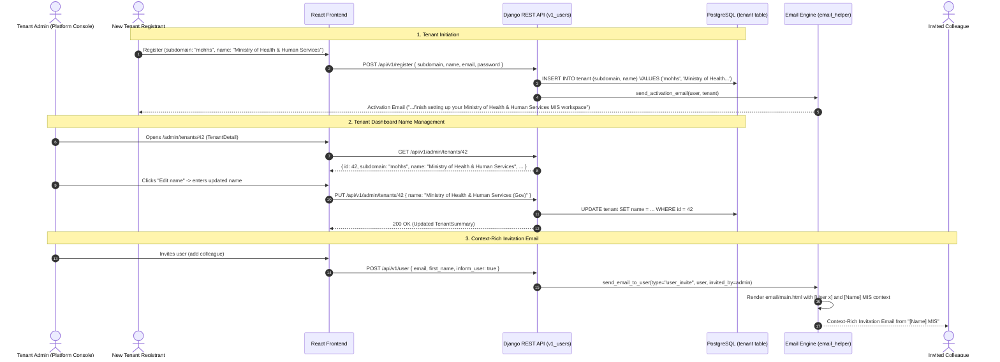

# MT-030: Tenant Name Parameter and Context-Rich Email - Feature Specification

> **GitHub Issue**: [#555](https://github.com/akvo/akvo-mis/issues/555)
> **Branch**: `feature/555-tenant-name-and-email-context`
> **Native Doc Path**: `doc/design/MT-030-tenant-name-and-email-context.md`

## Overview

Akvo MIS currently uses a single technical `subdomain` column (e.g., `mohhs`) on the `Tenant` model to identify a workspace. There is no dedicated `name` column in the database table `tenant` to store a workspace's full descriptive organisation name (e.g., `Ministry of Health & Human Services`).

Furthermore, system emails currently hardcode the platform title `Akvo MIS` in subject lines, headers, and body text. This lack of organisational context causes friction and confusion when inviting users—invitees often do not recognise "Akvo MIS" and may disregard invitations as phishing or spam.

This feature introduces:
1. **Tenant Name in Database**: Adds a `name` column to the `tenant` table and backfills existing workspaces using their `subdomain`.
2. **Tenant Initiation with Name**: Allows specifying the tenant name when registering/initiating a new MIS tenant.
3. **Tenant Name Management in Dashboard**: Enables Platform / Tenant Admins (us) to view and edit the tenant name from the Tenant Dashboard in the Platform Admin Console (`/admin/tenants/:id`).
4. **Tenant Name Parameter in All Emails**: Propagates the tenant name parameter to all outgoing system emails, substituting `Akvo MIS` with `[Name] MIS`.
5. **Context-Rich User Invitation Email**: Overhauls the user invitation email with inviter attribution (`[User x]`), clear purpose, prominent password setup button, "What happens next?" step-by-step guidance, administrator contact advice, and tenant sign-off.

---

## Architecture Overview



---

## 1. Backend Implementation

### 1.1 Database Model
**File**: `backend/api/v1/v1_users/models.py`

Add `name` field to `Tenant` model:

```python
class Tenant(models.Model):
    subdomain = models.CharField(max_length=63, unique=True)
    # Full organizational or display name (e.g. "Ministry of Health & Human Services")
    name = models.CharField(max_length=255, default="", blank=True)
    is_active = models.BooleanField(default=True)
    deleted_at = models.DateTimeField(default=None, null=True, blank=True)
    features = models.JSONField(default=dict, blank=True)
    language = models.CharField(max_length=10, default="en")
    logo = models.CharField(
        max_length=255, null=True, blank=True, default=None
    )
    created_at = models.DateTimeField(auto_now_add=True)

    def __str__(self):
        return self.name or self.subdomain

    @property
    def display_name(self):
        return self.name if self.name else self.subdomain

    @property
    def mis_title(self):
        base = self.display_name
        return base if base.upper().endswith("MIS") else f"{base} MIS"
```

### 1.2 Database Migration & Backfill
**File**: `backend/api/v1/v1_users/migrations/0014_tenant_name.py`

A two-step migration:
1. Schema change: `AddField` `name` on model `tenant` (`VARCHAR(255)`, default `""`, blank `True`).
2. Data migration: `RunPython` forward function to backfill existing tenants where `name` is empty or null with `subdomain`.
   ```python
   def backfill_tenant_name(apps, schema_editor):
       Tenant = apps.get_model("v1_users", "Tenant")
       for tenant in Tenant.objects.all():
           if not tenant.name:
               tenant.name = tenant.subdomain
               tenant.save(update_fields=["name"])
   ```
   Reverse function: `noop` or set `name = ""`.

### 1.3 Endpoints & Serializers

#### 1. Tenant Registration (`POST /api/v1/register`)
**File**: `backend/api/v1/v1_users/serializers.py` & `backend/api/v1/v1_users/views.py`
- Update `RegisterSerializer`:
  ```python
  name = serializers.CharField(
      max_length=255, required=False, allow_blank=True, default=""
  )
  ```
- In `register` view:
  ```python
  tenant_name = validated.get("name") or validated["subdomain"]
  tenant = Tenant.objects.create(
      subdomain=validated["subdomain"],
      name=tenant_name,
      language=validated.get("language", "en"),
  )
  ```

#### 2. Tenant Info (`GET /api/v1/tenant-info`)
**File**: `backend/api/v1/v1_users/views.py`
- Return `tenant.name` (falling back to `tenant.subdomain` if empty):
  ```python
  body = {
      "subdomain": tenant.subdomain,
      "name": tenant.name or tenant.subdomain,
      "language": getattr(tenant, "language", "en") or "en",
      "logo": tenant.logo,
  }
  ```

#### 3. Platform Admin Tenant Detail & Update (`GET`, `PUT /api/v1/admin/tenants/{id}`)
**File**: `backend/api/v1/v1_users/admin_views.py` & `backend/api/v1/v1_users/admin_serializers.py`
- In `TenantListSerializer` / `TenantSummarySerializer`:
  Update `get_name` to read `instance.name` directly (falling back to root administration or subdomain if blank):
  ```python
  def get_name(self, instance):
      if instance.name:
          return instance.name
      roots = [
          unit
          for unit in instance.administrations.all()
          if unit.parent_id is None
      ]
      return roots[0].name if roots else instance.subdomain
  ```
- In `tenant_detail` view (`PUT` method):
  Allow updating `name` in `request.data`:
  ```python
  elif request.method == "PUT":
      update_fields = []
      if "name" in request.data:
          tenant.name = (request.data.get("name") or "").strip() or tenant.subdomain
          update_fields.append("name")
      if "logo" in request.data:
          tenant.logo = request.data.get("logo") or None
          update_fields.append("logo")
      if update_fields:
          tenant.save(update_fields=update_fields)
  ```

#### 4. Workspace Branding & Settings (`PUT /api/v1/tenant/branding`)
**File**: `backend/api/v1/v1_users/serializers.py` & `backend/api/v1/v1_users/views.py`
- Update `TenantBrandingSerializer` to optionally accept `name` (`CharField(max_length=255, required=False)`).
- Allow workspace superadmins to update `tenant.name` from their workspace settings.

---

### 1.4 Email Subsystem Overhaul

**Files**:
- `backend/utils/email_helper.py`
- `backend/mis/templates/email/main.html`
- `backend/api/v1/v1_users/views.py`

#### 1. Universal Tenant Name Resolution
In `email_helper.py`:
- Extract `name` or `tenant_name` from `context`:
  1. `context.get("name")` or `context.get("tenant_name")`
  2. `context.get("tenant").name` (if tenant object passed)
  3. `context.get("user").tenant.name` (if user object passed)
  4. Fallback: `APP_NAME` ("Akvo MIS" or "mis").
- Compute `mis_name`:
  ```python
  raw_name = tenant_name or APP_NAME
  mis_name = raw_name if raw_name.upper().endswith("MIS") else f"{raw_name} MIS"
  ```
- In `send_email`:
  Prefix subject with `{mis_name}` instead of hardcoded `APP_NAME`:
  `"{0} - {1}".format(mis_name, context.get("subject"))`
  Set `site_name = mis_name`.

#### 2. Revamped Invitation Email (`EmailTypes.user_invite`)
Update context and template parameters for the exact user specification:
- **Inviter**: `admin = context.get("admin") or "Administrator"` (passed as `request.user.name` when an admin adds a user in `views.py:876` and `send_email_to_user`).
- **Subject**: `"New Invitation"` (resulting in `"{mis_name} - New Invitation"` or `f"Invitation to join {mis_name}"`).
- **Pre-Button Content**:
  - Salutation: `Hello,`
  - Opening: `{admin} has invited you to join {mis_name}.`
  - Value: `Through the platform, you'll be able to access the information and tools made available to you by your organisation.`
  - Call to Action: `To get started, set up your password using the button below. Once your account is activated, you can sign in to {mis_name} and access the platform using your account credentials.`
- **Action Button**:
  - Text: `Set Up Your Password`
  - URL: `{button_url}`
- **Post-Button Content ("What happens next?")**:
  - Heading: `What happens next?`
  - Steps:
    1. `Set up a secure password for your account.`
    2. `Sign in to {mis_name} using your registered email address and password.`
    3. `Explore the features and information available to you based on your organisation and assigned access permissions.`
  - Warning note: `If you weren't expecting this invitation, or believe it was sent to you by mistake, please contact your organisation's administrator before proceeding.`
  - Sign-off:
    `We look forward to welcoming you to {mis_name}.`
    `{name}` (e.g., `Ministry of Health & Human Services`)

#### 3. Update Other System Emails
- `EmailTypes.user_register`:
  `"You are receiving this email because you signed up to {mis_name}."`
- `EmailTypes.user_activation`:
  `"Welcome! Confirm your email address to finish setting up your {mis_name} workspace. Confirm within {TENANT_PURGE_AFTER_HOURS} hours — after that the workspace name is released."`
- `EmailTypes.user_update`:
  `"Your profile on {mis_name} has been updated by {admin}"`
- `EmailTypes.upload_error`:
  `"Your data upload to {mis_name} failed validation checks."`
- All other notifications (`data_approval`, `batch_approval`, `pending_approval`, etc.):
  Header and subject branded with `{mis_name}`.

#### 4. Email HTML Template Support (`main.html`)
- Enhance `backend/mis/templates/email/main.html` to support structured multi-paragraph blocks and post-button sections:
  - Add support for `post_button_text` / `after_button` block so "What happens next?" renders cleanly below the `[Set Up Your Password]` button.
  - Preserve whitespace/paragraphs or iterate over list items for reliable rendering across all email clients.

---

## 2. Frontend Implementation

### 2.1 Tenant Initiation / Registration
**File**: `frontend/src/pages/register/Register.jsx`

Add "Workspace name" input field to the registration form:
- Form Item:
  ```jsx
  <Form.Item
    name="name"
    label="Workspace name"
    extra="The full name of your organisation (e.g. Ministry of Health & Human Services)."
    rules={[
      { required: false },
      { max: 255, message: "Workspace name cannot exceed 255 characters." }
    ]}
  >
    <Input
      disabled={loading}
      placeholder="e.g. Ministry of Health & Human Services"
    />
  </Form.Item>
  ```
- Included in submission payload to `api.post("register", values)`.

### 2.2 Platform Admin Tenant Dashboard (TenantDetail)
**File**: `frontend/src/pages/admin/TenantDetail.jsx`

Enable Tenant Admins (us) to change the tenant name:
- In `TenantDetail.jsx` header (beside `tenant.subdomain` and `tenant.name`):
  Add an "Edit name" button / modal trigger.
- When clicked, opens a clean Modal dialog:
  - Input field pre-filled with current `tenant.name || tenant.subdomain`.
  - Save button triggers `api.put(`admin/tenants/${id}`, { name: updatedName })`.
  - On success: updates local `tenant` state (`setTenant(res.data)`), displays success notification (`"Workspace name updated"`).
- Wireframe:
  ```text
  +--------------------------------------------------------------------------+
  | < All Workspaces                                                         |
  |                                                                          |
  | [Logo]  mohhs  [Active]                                                  |
  |         Ministry of Health & Human Services  [Edit Name]                 |
  |                                                                          |
  |         [Upload logo]  [Remove logo]                                     |
  |         [Inspect Workspace]  [Suspend]  [Rename Subdomain]               |
  |                                                                          |
  | +-----------+ +-----------+ +-----------+ +-----------+ +-----------+    |
  | | Users: 12 | | Forms: 5  | | Dash.: 3  | | Data: 120 | | Dev.: 8   |    |
  | +-----------+ +-----------+ +-----------+ +-----------+ +-----------+    |
  +--------------------------------------------------------------------------+
  ```

### 2.3 Browser Document Title & State (Option B: Fully Whitelisted Site Title)
**File**: `frontend/src/util/tenant.js`

Update document title logic to Option B:
```javascript
const rawTitle = tenant?.name || (tenant?.subdomain ? startCase(tenant.subdomain) : "");
if (rawTitle) {
  // Deduplicate suffix if name already ends with 'MIS' (e.g. 'Kenya Health MIS')
  document.title = rawTitle.toUpperCase().endsWith("MIS") ? rawTitle : `${rawTitle} MIS`;
} else {
  document.title = "Akvo MIS";
}
```
* Examples:
  * Tenant `name="Ministry of Health & Human Services"` -> Title: `Ministry of Health & Human Services MIS`
  * Tenant `name="Kenya Health MIS"` -> Title: `Kenya Health MIS`
  * Legacy tenant without name, `subdomain="mohhs"` -> Title: `Mohhs MIS`
  * Base/Admin domain without tenant in scope -> Title: `Akvo MIS`


---

## 3. Verification & Testing

### 3.1 Automated Tests
Execute using official Docker Compose wrapper:
- **Backend Tests**:
  - Model & Migration: `./dc.sh exec backend python manage.py test api.v1.v1_users.tests.tests_tenant`
  - Registration with Name: `./dc.sh exec backend python manage.py test api.v1.v1_users.tests.tests_register`
  - Admin Tenant Detail & Update: `./dc.sh exec backend python manage.py test api.v1.v1_users.tests.tests_admin_tenants api.v1.v1_users.tests.tests_admin_summary`
  - Email Delivery & Content: `./dc.sh exec backend python manage.py test api.v1.v1_users.tests.tests_invite_email_delivery api.v1.v1_users.tests.tests_email_send_logging`
- **Frontend Tests**:
  - `./dc.sh exec frontend npm test -- src/pages/register/__test__/Register.test.js`
  - `./dc.sh exec frontend npm test -- src/pages/admin/__test__/TenantDetail.test.js`
  - `./dc.sh exec frontend npm test -- src/util/__test__/tenant.test.js`
- **Linters**:
  - `./dc.sh exec backend flake8`
  - `./dc.sh exec frontend npm run lint`

### 3.2 Manual Verification Steps
1. **Migration Verification**: Apply migration on an existing database with tenants (`./dc.sh exec backend python manage.py migrate`). Verify that all existing tenant rows have `name = subdomain`.
2. **Tenant Registration**: Register a new tenant with name `"Ministry of Health & Human Services"` and subdomain `"mohhs"`. Verify row created in DB with correct `name`.
3. **Activation Email Inspection**: Verify received activation email contains `"Ministry of Health & Human Services MIS"` in subject and body.
4. **Tenant Dashboard Modification**: As Platform Admin, navigate to `/admin/tenants/<id>`. Click "Edit name", update name to `"MOHHS Public Health"`. Save and verify immediate update in UI and database.
5. **Invitation Email Inspection**: Invite a new user. Verify received email matches the exact new specification:
   - Greeting & inviter name (`[User x] has invited you to join MOHHS Public Health MIS`).
   - `[Set Up Your Password]` button in the middle.
   - "What happens next?" instructions below button.
   - Administrator contact advice and sign-off from `MOHHS Public Health`.
6. **Other Emails**: Test password reset and profile update to verify tenant name appears consistently across all subjects and bodies.

---

## 4. Epic & Vibe Coding Estimation ⏱️

- **Confidence Level**: High
- **Dependencies**: None (self-contained within `v1_users`, `utils/email_helper`, and frontend admin/register)

| Task ID | Component & Description | Vibe Coding (Dev) | Automated Testing | QA & Review | Total Est. Time | Priority |
| :--- | :--- | :---: | :---: | :---: | :---: | :--- |
| **T-001** | **Backend**: Add `Tenant.name` field & migration with data backfill (`subdomain` -> `name`) | 25m | 20m | 15m | **60m (1.0h)** | Must Have |
| **T-002** | **Backend**: Update `RegisterSerializer`, `register` view, `tenant_info`, and `admin_views.tenant_detail` (PUT `name`) | 35m | 25m | 15m | **75m (1.25h)** | Must Have |
| **T-003** | **Backend**: Universal email engine tenant name resolution (`email_helper.py`, subject prefix, `[Name] MIS` dynamic naming across all email types) | 40m | 30m | 20m | **90m (1.5h)** | Must Have |
| **T-004** | **Backend**: Revamped context-rich invitation email (`user_invite`, `main.html` layout, steps, inviter attribution) | 45m | 30m | 15m | **90m (1.5h)** | Must Have |
| **T-005** | **Frontend**: Add Workspace Name field to registration form (`Register.jsx` validation & payload) | 25m | 20m | 15m | **60m (1.0h)** | Must Have |
| **T-006** | **Frontend**: Platform Admin Tenant Dashboard editing (`TenantDetail.jsx` Edit Name modal/form, update API call, title update in `tenant.js`) | 40m | 25m | 15m | **80m (1.33h)** | Must Have |
| **T-007** | **QA & Verification**: End-to-end integration tests, email preview tests, flake8, and frontend lint checks | 20m | 35m | 20m | **75m (1.25h)** | Must Have |
| **TOTAL** | **Full Feature Implementation** | **230m** | **185m** | **115m** | **530m (~8.8h)** | |

---

## 🛑 HALT
*Phase 0 complete. Awaiting review and approval before proceeding to implementation.*
