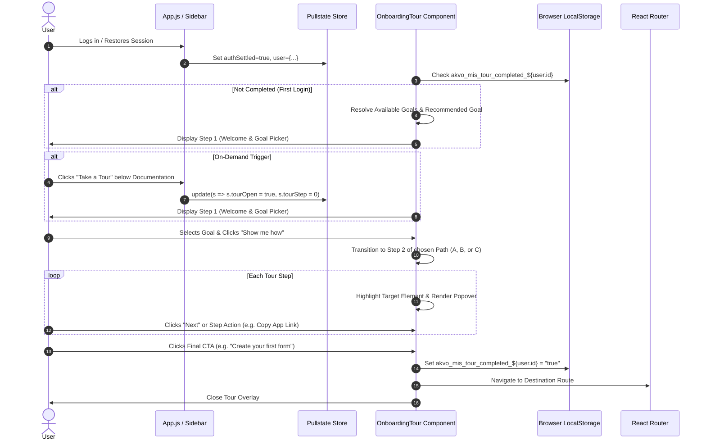

# [#561] Tour for the First User Login - Implementation Plan & Feature Spec

> **Feature Design Standard**: Aligned with Akvo MIS `doc/templates/FEATURE_DESIGN_TEMPLATE.md` and `.agent/templates/FEATURE_SPEC.md`.
> **Task ID**: [#561] TOUR-001 (GitHub: #561 / Asana: "Create a tour functionality for first user logins")
> **Date**: 2026-10-26
> **Status**: Approved

---

## 1. Context & Problem Statement

```text
Currently:
- When a user logs in for the first time, they are dropped into the Control Center with no guided introduction or role-specific pathway.
- Existing tour elements in ControlCenterTour.jsx and ProfileTour.jsx are legacy carousel image modals hidden behind a small icon, lacking dynamic goal-based onboarding, spotlighting, or direct actionable CTAs.
- Users often find it difficult to know where to begin (e.g. creating forms, distributing the mobile app, reviewing approvals, or creating dashboards).

Goal:
- Implement a role-adaptive, max 7-step onboarding tour template that launches automatically on first user login.
- Provide a Step 1 "Welcome & Goal Picker" where users select their primary objective (Setup, Review, or Explore) with intelligent preselection and recommendation by user role.
- Provide tailored pathways:
  * Path A: Setup (Set up a data collection) - 4 steps (+ Step 1 = 5 steps)
  * Path B: Review (Review and approve data) - 3 steps (+ Step 1 = 4 steps)
  * Path C: Explore (Explore data and dashboards) - 4 steps (+ Step 1 = 5 steps)
- Conclude every path with a unified "Get help any time" step (highlighting the AI Chatbot and Documentation).
- Provide on-demand re-triggering via a new menu item below "Documentation" in the left sidebar ("Take a Tour").
```

---

## 2. Requirements & 5W1H Analysis

### 2.1 5W1H Framework
- **Who**: 
  - Super Admin & Admin: See Setup (Recommended), Review, and Explore.
  - Approver: Sees Review (Recommended) and Explore.
  - Data Viewer / Submitter / Other: Sees Explore (Preselected without choice).
- **What**: 
  - Welcome & Goal Picker modal on first login.
  - Interactive guided tour overlay highlighting target sidebar and workspace elements.
  - "Copy app link" button in Path A for mobile app distribution.
  - Direct deep-link CTAs on the final step (Form Builder Create, Approvals page, Dashboard Builder Create).
  - On-demand tour launcher in the sidebar below Documentation.
- **Where**: 
  - Frontend: `frontend/src/components/onboarding-tour/`, `frontend/src/components/sidebar/index.jsx`, `frontend/src/App.js`, `frontend/src/lib/store.js`, `frontend/src/lib/ui-text.js`.
  - Backend: No schema changes required; state persisted in `localStorage` keyed per user and workspace (`akvo_mis_tour_completed_${userId}_${subdomain}`).
- **When**: 
  - Auto-launched when an authenticated user enters the workspace for the first time.
  - Triggered on-demand when clicking "Take a Tour" in the sidebar.
- **Why**: 
  - Reduces time-to-first-value to under 1 minute and ensures new users understand core capabilities.
- **How**: 
  - Lightweight React tour component with backdrop overlay, target element spotlighting/anchoring, Pullstate store integration, and i18n support.

### 2.2 User Acceptance Criteria
- [ ] **UAC-01 (Step 1 - Welcome & Goal Picker)**: Displays "Welcome to Akvo MIS" and "What do you want to do first? We’ll show you around in under a minute."
- [ ] **UAC-02 (Role Filtering & Recommendations)**:
  - Super admin and admin see `setup` (labelled "Recommended" and preselected), `review`, and `explore`.
  - Approvers (with `is_approver` flag) see `review` (labelled "Recommended" and preselected) and `explore`.
  - Roles seeing only one option (Data Viewer / Submitter) see `explore` preselected without a choice selector.
- [ ] **UAC-03 (Path A - Setup)**:
  - Step 2: "Build a form" highlighting Form Builder.
  - Step 3: "Get the app to your field team" highlighting Download App + working "Copy app link" button.
  - Step 4: "Watch submissions arrive" highlighting Data/Submissions.
  - Step 5: "Get help any time" highlighting AI Chatbot & Documentation + CTA "Create your first form" navigating to `/control-center/form-builder/create`.
- [ ] **UAC-04 (Path B - Review)**:
  - Step 2: "Your pending approvals" highlighting Control Center Approvals panel.
  - Step 3: "Review submissions" highlighting Data menu.
  - Step 4: "Get help any time" highlighting AI Chatbot & Documentation + CTA "Review pending approvals" navigating to `/control-center/approvals`.
- [ ] **UAC-05 (Path C - Explore)**:
  - Step 2: "Browse your data" highlighting Data menu.
  - Step 3: "Chart it in a dashboard" highlighting Dashboards menu.
  - Step 4: "Download your data" highlighting Downloads menu.
  - Step 5: "Get help any time" highlighting AI Chatbot & Documentation + CTA "Create a dashboard" navigating to `/control-center/dashboard` with create modal opened.
- [ ] **UAC-06 (On-Demand Launch)**: Sidebar has a "Take a Tour" menu item directly below "Documentation" that re-opens the tour at Step 1 anytime.
- [ ] **UAC-07 (First-Login Auto Trigger & Dismissal)**:
  - Automatically pops up on first login if not previously completed or dismissed.
  - Clicking "Skip" or completing the tour records completion and suppresses automatic display on subsequent logins.

### 2.3 Technical Acceptance Criteria
- [ ] Ant Design 4 compatible (does not rely on antd v5 Tour component).
- [ ] Zero external dependencies added to `frontend/package.json`.
- [ ] Multi-language support in `frontend/src/lib/ui-text.js` (English and German).
- [ ] Unit and component test coverage ≥80% for all new and modified frontend files.
- [ ] ESLint strict compliance (`curly: error`, `no-undefined: warn`, `prefer-arrow-callback: error`).

---

## 3. Architecture Overview

### 3.1 Architecture Flow
1. **Bootstrap & Evaluation**: When `App.js` completes auth restore (`authSettled: true`, `isLoggedIn: true`, `user` is non-null), `OnboardingTour` evaluates if:
   - Host is a workspace host (`!onAdminHost()`).
   - Session is NOT an inspection session (`!user?.is_inspecting`).
   - Tour has not been completed or dismissed (`!localStorage.getItem("akvo_mis_tour_completed_${user.id}_${tenantSubdomain}")`).
2. **Goal Resolution**: If eligible (or if triggered on-demand via the sidebar), `getAvailableGoals(user)` and `getRecommendedGoal(user)` determine the visible and preselected goals.
3. **Step Navigation**: The user progresses through Step 1 (Goal Picker modal) into Steps 2-5 (anchored spotlight popover).
4. **Spotlight & Target Positioning**: Each step queries the DOM for its `targetSelector` (e.g. `[data-tour="sidebar-form-builder"]`). If found and visible, the overlay cuts out a spotlight around the target using an overlay box-shadow/SVG mask; if not present or off-screen (e.g. mobile drawer collapsed or on another page), it renders as a clean centered modal.
5. **Interactive Actions & CTAs**:
   - Step 3 ("Get the app"): Safe clipboard write with fallback (`navigator.clipboard?.writeText` with `execCommand` fallback) and toast notification.
   - Final CTA: Safe internal React Router navigation; for Path C, triggers `CreateDashboardModal` open.
6. **Completion / Dismissal**: Clicking "Skip", the close button ("X"), or the final CTA updates `localStorage` and closes the tour.

### 3.2 Mermaid Sequence Diagram



---

## 4. Role Matrix & Goal Routing Engine

| User Role Profile | Evaluated Flags | Visible Goals | Recommended Goal | Step 1 Display Mode |
| :--- | :--- | :--- | :--- | :--- |
| **Super Admin** | `is_superuser === true` | `setup`, `review`, `explore` | `setup` | Radio picker with "Recommended" badge on Setup |
| **Tenant Admin** | `can_form_create \|\| can_form_builder \|\| role.includes("Admin")` | `setup`, `review`, `explore` | `setup` | Radio picker with "Recommended" badge on Setup |
| **Approver** | `!isAdmin && is_approver === true` | `review`, `explore` | `review` | Radio picker with "Recommended" badge on Review |
| **Data Viewer / Submitter** | `!isAdmin && !is_approver` | `explore` | `explore` | Preselected card without choice selection |

---

## 5. Detailed Step & Path Specifications

### Step 1: Welcome and Goal Picker (All Roles)
- **Title**: `Welcome to Akvo MIS`
- **Subtitle**: `What do you want to do first? We’ll show you around in under a minute.`
- **Options**:
  - `setup`:
    - Title: `Set up a data collection`
    - Subtitle: `Build a form and get it to your field team`
    - Badge: `Recommended` (when role is Super admin or Admin)
  - `review`:
    - Title: `Review and approve data`
    - Subtitle: `Check submissions waiting for you`
    - Badge: `Recommended` (when role is Approver)
  - `explore`:
    - Title: `Explore data and dashboards`
    - Subtitle: `Browse, chart and download results`
    - Badge: `Recommended` (when role is Data Viewer)
- **Buttons**:
  - `Show me how` (Primary Antd button) -> Advances to Step 2 of chosen path.
  - `Skip` (Ghost/text button) -> Dismisses tour and sets completion in `localStorage`.

---

### Path A: `setup` — Set Up a Data Collection (4 steps + Step 1 = 5 steps)

| Step | Indicator | Title | Body Text | Target Element Selector | Actions / Buttons |
| :---: | :---: | :--- | :--- | :--- | :--- |
| **2** | `STEP 2 OF 5` | **Build a form** | Add sections and questions, then publish. Your field team can fill it in as soon as it is published. | `[data-tour="sidebar-form-builder"]` (Sidebar Form Builder) | `[Back]` `[Next]` |
| **3** | `STEP 3 OF 5` | **Get the app to your field team** | Your field team collects data offline in the mobile app. Share the download link with them. | `[data-tour="sidebar-download-apps"]` (Sidebar Download App) | `[Copy app link]` (copies `${origin}/app`)<br/>`[Back]` `[Next]` |
| **4** | `STEP 4 OF 5` | **Watch submissions arrive** | New submissions from the field appear here. Filter by form, or add one yourself from the web. | `[data-tour="submissions-section"]` or `[data-tour="sidebar-data"]` | `[Back]` `[Next]` |
| **5** | `STEP 5 OF 5` | **Get help any time** | Have questions? Use our AI assistant anytime at the bottom right, or browse our Documentation for in-depth guides. | `[data-tour="chatbot-launcher"]` & `[data-tour="sidebar-documentation"]` | `[Back]`<br/>**Primary CTA**: `Create your first form` -> `/control-center/form-builder/create` |

---

### Path B: `review` — Review and Approve Data (3 steps + Step 1 = 4 steps)

| Step | Indicator | Title | Body Text | Target Element Selector | Actions / Buttons |
| :---: | :---: | :--- | :--- | :--- | :--- |
| **2** | `STEP 2 OF 4` | **Your pending approvals** | Submissions waiting for your decision land here. You can also see what your subordinate approvers still have to review. | `[data-tour="panel-approvals"]` (Control Center Approvals Panel) | `[Back]` `[Next]` |
| **3** | `STEP 3 OF 4` | **Review submissions** | Open Manage Data to browse and filter submissions. Approvals and drafts also live under Data. | `[data-tour="sidebar-data"]` (Sidebar Data / Manage Data) | `[Back]` `[Next]` |
| **4** | `STEP 4 OF 4` | **Get help any time** | Have questions? Use our AI assistant anytime at the bottom right, or browse our Documentation for in-depth guides. | `[data-tour="chatbot-launcher"]` & `[data-tour="sidebar-documentation"]` | `[Back]`<br/>**Primary CTA**: `Review pending approvals` -> `/control-center/approvals` |

---

### Path C: `explore` — Explore Data and Dashboards (4 steps + Step 1 = 5 steps, or 4 steps for Data Viewers)

| Step | Indicator | Title | Body Text | Target Element Selector | Actions / Buttons |
| :---: | :---: | :--- | :--- | :--- | :--- |
| **2** | `STEP 2 OF 5` | **Browse your data** | Open Manage Data to browse, filter and review submissions by form and location. | `[data-tour="sidebar-data"]` (Sidebar Data / Manage Data) | `[Back]` `[Next]` |
| **3** | `STEP 3 OF 5` | **Chart it in a dashboard** | Build a dashboard from your data, publish it, then keep it private or share it publicly. *(Omitted if user lacks `read dashboard` permission)* | `[data-tour="sidebar-dashboards"]` (Sidebar Dashboards) | `[Back]` `[Next]` |
| **4** | `STEP 4 OF 5` | **Download your data** | Export submissions from Manage Data. Large exports run in the background and wait for you here. | `[data-tour="sidebar-downloads"]` (Sidebar Downloads) | `[Back]` `[Next]` |
| **5** | `STEP 5 OF 5` | **Get help any time** | Have questions? Use our AI assistant anytime at the bottom right, or browse our Documentation for in-depth guides. | `[data-tour="chatbot-launcher"]` & `[data-tour="sidebar-documentation"]` | `[Back]`<br/>**Primary CTA**: `Create a dashboard` -> `/control-center/dashboard` (or `Browse data` -> `/control-center/data` if user lacks dashboard create rights) |

> [!NOTE]
> **Dynamic Permission Adaptation (CASL Ability)**:
> In Akvo MIS, `read dashboard` gates the dashboard builder and requires `can_dashboard_create/edit/publish/delete`. Users with only viewer access do not have the Dashboards sidebar menu item.
> The tour dynamically evaluates `getTourPath(goal, ability)`:
> 1. Restricts path steps strictly to features visible to the user's role (e.g. omitting Step 3 for Viewers so no spotlight is broken).
> 2. Dynamically updates total steps count (`getTotalStepsForGoal(goal, ability)` -> `STEP X OF 4`).
> 3. Resolves the final CTA dynamically (`dynamicCta`): providing "Browse data" (`/control-center/data`) instead of "Create a dashboard" to prevent 403 Forbidden navigation.

---

## 6. Frontend UI Wireframes & Mockups

### 6.1 Step 1: Welcome & Goal Picker Modal

```text
+-------------------------------------------------------------------------+
|                                                                     [X] |
|  STEP 1 OF 5                                                            |
|  Welcome to Akvo MIS                                                    |
|  What do you want to do first? We'll show you around in under a minute. |
|                                                                         |
|  +-------------------------------------------------------------------+  |
|  | (o) Set up a data collection                         [Recommended]|  |
|  |     Build a form and get it to your field team                    |  |
|  +-------------------------------------------------------------------+  |
|  | ( ) Review and approve data                                       |  |
|  |     Check submissions waiting for you                             |  |
|  +-------------------------------------------------------------------+  |
|  | ( ) Explore data and dashboards                                   |  |
|  |     Browse, chart and download results                            |  |
|  +-------------------------------------------------------------------+  |
|                                                                         |
|  [ Skip ]                                            [ Show me how -> ] |
+-------------------------------------------------------------------------+
```

### 6.2 Steps 2-5: Interactive Anchored Step Card

```text
+-----------------------------------------------------------+
| [Target Element Highlighted with Spotlight / Glow Ring]   |
+-----------------------------------------------------------+
         |
         v
    +-------------------------------------------------------+
    | STEP 3 OF 5                                       [X] |
    | Get the app to your field team                        |
    |                                                       |
    | Your field team collects data offline in the mobile   |
    | app. Share the download link with them.               |
    |                                                       |
    | [ 📋 Copy app link ]                                  |
    |                                                       |
    | [ <- Back ]                                 [ Next ->]|
    +-------------------------------------------------------+
```

---

## 7. Implementation Touchpoints

### 7.1 Frontend Files to Create & Modify

```markdown
### 🎯 Scope Boundary Declaration
- **[CREATE]** `frontend/src/components/onboarding-tour/OnboardingTour.jsx`
  - Core component managing tour overlay, spotlighting, step navigation, and dismissal.
- **[CREATE]** `frontend/src/components/onboarding-tour/tourConfig.js`
  - Declarative configuration of paths, steps, target selectors, role mappings, and CTAs.
- **[CREATE]** `frontend/src/components/onboarding-tour/style.scss`
  - Styling for modal, radio goal options, recommended badges, backdrop cutout, and animations.
- **[CREATE]** `frontend/src/components/onboarding-tour/__test__/OnboardingTour.test.jsx`
  - Unit and integration tests covering role detection, step progression, copy app link, and CTAs.
- **[MODIFY]** `frontend/src/components/sidebar/index.jsx`
  - Add data attributes: `data-tour="sidebar-..."`.
  - Add "Take a Tour" menu item below "Documentation" (`key="menu-product-tour"`).
- **[MODIFY]** `frontend/src/App.js`
  - Mount `<OnboardingTour />` conditionally for workspace routes (alongside `ChatbotWidget`).
- **[MODIFY]** `frontend/src/lib/store.js`
  - Add `tourOpen: false`, `tourGoal: null`, `tourStep: 0` to Pullstate UI state.
- **[MODIFY]** `frontend/src/lib/ui-text.js`
  - Add i18n keys for all tour titles, bodies, goal descriptions, badges, and button labels (EN & DE).
- **[MODIFY]** `frontend/src/pages/dashboards/DashboardList.jsx`
  - Support auto-opening `CreateDashboardModal` when `location.state?.openCreate || searchParam create=true`.
```

### 7.2 Backend Implementation
- **No backend changes or migrations required.**
- State is safely stored in `localStorage` under `akvo_mis_tour_completed_${authUser.id}_${tenantSubdomain}`.
- If the user switches workspaces or logs in with another account, the tour correctly activates for their profile.

---

## 8. Decision Log

### D-1: Client-Side (`localStorage`) vs Backend User Model Column
- **Options Considered**:
  1. Add a `has_completed_tour` boolean field to `SystemUser` via Django migration.
  2. Use browser `localStorage` keyed per user and tenant subdomain.
- **Decision**: Option 2 (`localStorage`).
- **Rationale**: The feature is purely an onboarding UX aid. Adding a backend column requires schema migrations across multi-tenant databases and API serializer modifications. Client-side storage is instantaneous, zero-latency, and allows the "Take a Tour" menu to re-launch the tour at will on demand.
- **Impact**: Zero database risk, zero migration downtime, localized completely to frontend.

### D-2: Custom Lightweight Modal/Spotlight vs Third-Party Library (e.g. driver.js / react-joyride)
- **Options Considered**:
  1. Install external library like `driver.js` or `react-joyride`.
  2. Implement an in-house React 17 + Antd 4 accessible tour overlay component.
- **Decision**: Option 2 (In-house React + Ant Design component).
- **Rationale**: Akvo MIS operates with React 17 and Antd 4. Third-party tour libraries introduce bundle bloat (20-40kB), CSS collision issues, and accessibility/compatibility friction with Antd components. An in-house component strictly satisfies all requirements with exact styling parity to the design attachment.
- **Impact**: No new npm dependencies, 100% theme consistency, full control over transitions and role logic.

### D-3: Target Fallback Positioning
- **Options Considered**:
  1. Hard fail if a target element is not found on screen.
  2. Fallback to centered dialog when target element is absent.
- **Decision**: Option 2.
- **Rationale**: If a user has collapsed the sidebar or navigates away during the tour, the tour should seamlessly display in the center rather than breaking.
- **Impact**: Resilient UX on all screen sizes and viewport states.

---

## 8.1 Security & Edge Case Mitigations (BMAD Party Deliberation)

- **[SEC-01] Inspection Mode Suppression**:
  - Operators viewing a workspace (`user.is_inspecting === true`) MUST NOT have the onboarding tour automatically triggered. Operators perform support/auditing and should not have modal interruptions or write CTAs presented.
- **[SEC-02] Admin/Console Host Exclusion**:
  - The tour component is mounted with `{!onAdminHost() && <OnboardingTour />}` to guarantee it never executes on the platform console domain (`admin.<domain>`).
- **[SEC-03] Safe Clipboard API Fallback**:
  - "Copy app link" uses `navigator.clipboard?.writeText(url)` wrapped in a `try...catch` block with fallback to `document.execCommand('copy')` if running in unsecure HTTP context or test environments.
- **[SEC-04] Zero PII in LocalStorage**:
  - The storage key strictly contains opaque identifiers: `akvo_mis_tour_completed_${authUser.id}_${subdomain || 'root'}` and stores only `"true"`. No emails, roles, or tokens are serialized.
- **[SEC-05] Route Guard Parity**:
  - Even if a client tampered with `tourGoal`, all final CTAs navigate via React Router to endpoints protected by existing `<Private />` route guards and CASL ability checks (`ability.can("create", "form-builder")`). Unprivileged users cannot trigger unauthorized actions.

---

## 9. Verification & Testing Strategy

### 9.1 Automated Tests
- Run command: `./dc.sh exec frontend npm test frontend/src/components/onboarding-tour`
- Test cases:
  1. **Goal Picker Role Filtering**:
     - Super admin: shows `setup` (recommended), `review`, `explore`.
     - Approver: shows `review` (recommended), `explore`.
     - Data Viewer: shows `explore` preselected without choices.
  2. **Path Progression**:
     - Selecting Path A progresses through Steps 1 -> 2 -> 3 -> 4 -> 5.
     - Selecting Path B progresses through Steps 1 -> 2 -> 3 -> 4.
     - Selecting Path C progresses through Steps 1 -> 2 -> 3 -> 4 -> 5.
  3. **Interactive Actions**:
     - "Copy app link" invokes `navigator.clipboard.writeText` with `${origin}/app` and triggers success toast.
     - "Skip" dismisses tour and sets `localStorage` key.
     - Final CTAs invoke router navigation to expected destination routes.
  4. **On-Demand Launch**:
     - Clicking "Take a Tour" in the sidebar opens the tour at Step 1 even if `localStorage` has the completion flag.

### 9.2 Manual Smoke Verification
1. Login as Super Admin -> Verify tour modal opens automatically with Setup preselected as Recommended.
2. Click "Show me how" -> Verify progression through Steps 2-5 with spotlighting on sidebar elements.
3. Test "Copy app link" button -> Verify link copied to clipboard.
4. Click "Create your first form" -> Verify redirection to `/control-center/form-builder/create`.
5. Login as Approver -> Verify only Review (Recommended) and Explore are visible.
6. Login as Data Viewer -> Verify only Explore is shown preselected.
7. Click "Take a Tour" below Documentation in the sidebar -> Verify tour reopens immediately.

---

## 10. Epic & Vibe Coding Estimation ⏱️

- **Confidence Level**: High (Clear specifications, visual mockups provided, zero backend dependencies)
- **Dependencies**: None (Uses existing React 17, Antd 4, and Pullstate store)

| Task ID | Component & Description | Vibe Coding (Dev) | Automated Testing | QA & Review | Total Est. Time | Priority |
| :--- | :--- | :---: | :---: | :---: | :---: | :--- |
| **TOUR-01** | **Tour Configuration & Role Engine**<br/>`tourConfig.js` defining all 3 paths, step content, selectors, role resolver (`getAvailableGoals`, `getRecommendedGoal`). | 20m | 15m | 10m | **45m (0.75h)** | P1 |
| **TOUR-02** | **Core OnboardingTour Component & Styling**<br/>`OnboardingTour.jsx` & `style.scss` with backdrop overlay, spotlight calculation, Step 1 Goal Picker, and step navigation. | 35m | 25m | 15m | **75m (1.25h)** | P1 |
| **TOUR-03** | **Interactive Actions & Final CTAs**<br/>"Copy app link" button with clipboard write, final step navigation buttons (Form Builder, Approvals, Dashboard Create modal trigger). | 20m | 15m | 10m | **45m (0.75h)** | P1 |
| **TOUR-04** | **Sidebar Menu & First-Login Persistence**<br/>Add "Take a Tour" below Documentation in `sidebar/index.jsx`, auto-trigger in `App.js` with `localStorage` scoping, and Pullstate store hooks. | 20m | 15m | 10m | **45m (0.75h)** | P1 |
| **TOUR-05** | **Localization (i18n) & Regression Suite**<br/>Add English and German keys to `ui-text.js`, update snapshots, and run full frontend test & lint suites. | 15m | 15m | 10m | **40m (0.65h)** | P2 |
| **TOTAL** | **Full Feature Implementation** | **110m** | **85m** | **55m** | **250m (~4.1h)** | - |
